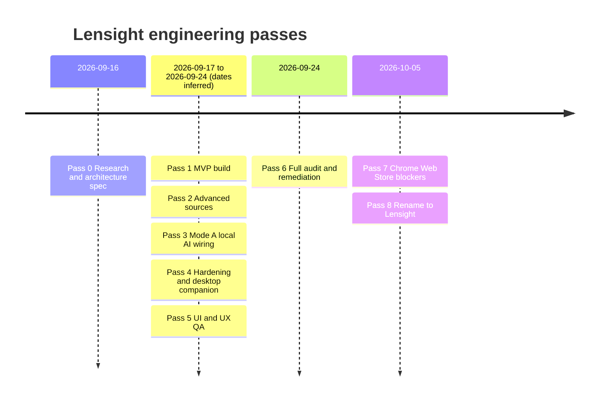
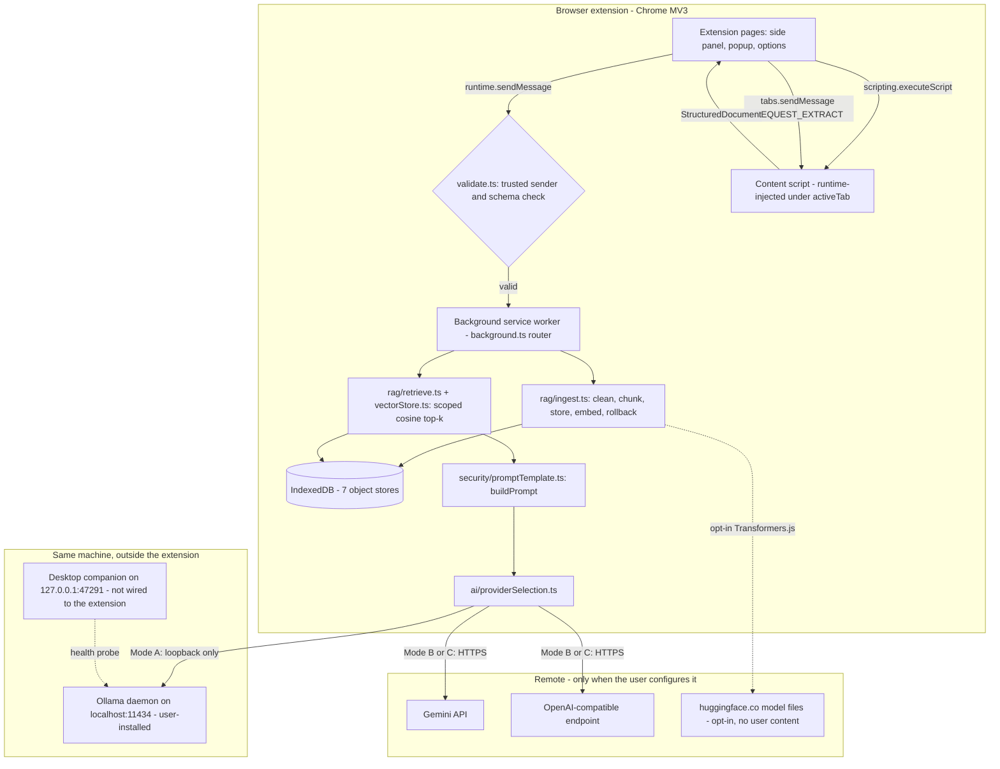
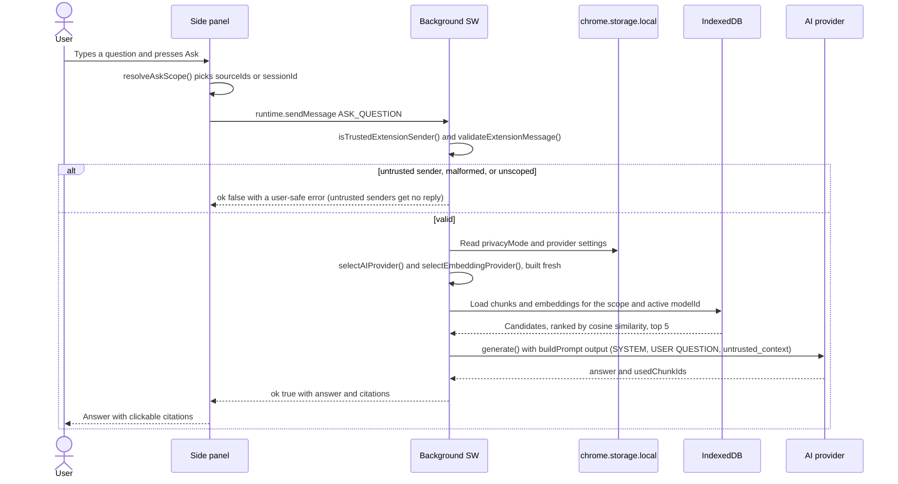
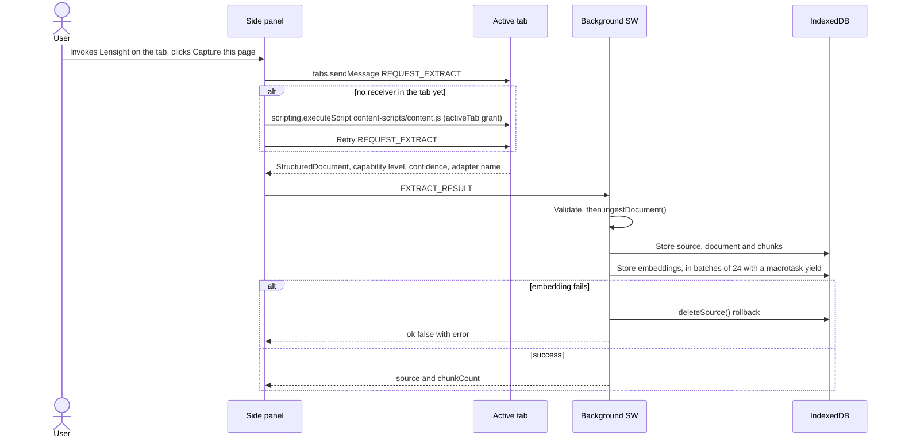
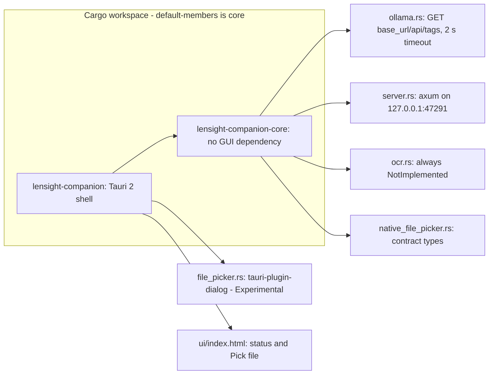

# Lensight: Engineering Project Report

> **Lensight is a local-first AI context assistant: a Chrome Manifest V3 extension (plus an optional Rust/Tauri desktop companion) that captures what you are viewing, indexes it on your own device, and answers questions with citations. It sends only the retrieved excerpts to an AI model, and only to one you chose.**

| | |
|---|---|
| **Stack** | TypeScript 5.5, React 18.3, Tailwind CSS 3.4, WXT 0.21 (Manifest V3), IndexedDB via `idb` 8, `pdfjs-dist` 6.4.299, `@huggingface/transformers` 4.3.0 with packaged ONNX Runtime WASM, Vitest 5, Playwright 1.47, axe-core; companion in Rust (axum 0.7, tokio, reqwest) and Tauri 2 |
| **Version / status** | `lensight` v0.1.0. MVP, **pre-launch**: not published to any store, no users, no revenue ✅ |
| **Last updated** | 2026-10-05 |
| **Evidence sources** | `docs/fixed.md` (engineering log), `docs/info.md` (PRD/reference), `docs/pitch.md`, `docs/ARCHITECTURE.md`, `docs/LIMITATIONS.md`, `docs/SECURITY.md`, `docs/PRIVACY.md`, `docs/PRIVACY_POLICY.md`, `docs/SETUP.md`, `docs/PERFORMANCE.md`, `docs/STORE_SUBMISSION.md`, `docs/README.md`, `../universal-ai-context-assistant-research.md` (original research, 2026-09-16), `../REMEDIATION_REPORT_ai-context-assistant_2026-09-24.md` (audit), `../desktop-companion/README.md`, plus a live inspection of the codebase and real commands re-run on 2026-10-05 (see [Appendix C](#appendix-c-verification-commands-and-output)) |
| **Confidence split** | Counted by tag occurrence, legend excluded: **≈431 ✅ Verified (~90%)** · **≈43 🟡 Inferred (~9%)** · **2 ❓ Unknown**, plus ≈23 `[TO CONFIRM]` markers and 20 `[ADD METRIC]` placeholders. Most 🟡 items concern pass dates and who made which decision, not technical facts |

**Legend**

| Tag | Meaning |
|---|---|
| ✅ Verified | Backed by a project document with recorded command output, or re-checked against the code or a real command on 2026-10-05 |
| 🟡 Inferred | A reasonable reading of the evidence that no document states outright (for example, dates inferred from file timestamps) |
| ❓ Unknown | Not in the evidence. Always paired with `[TO CONFIRM: ...]` |
| `[ADD METRIC: ...]` | A number that does not exist yet. This report does not invent one. |
| ⭐ | Core feature: part of the product's central promise |
| 🔥 | Technically hard or interview-worthy |
| 🚀 | Shipped or materially improved in the latest passes (audit on 2026-09-24, store-blocker pass on 2026-10-05) |

> **How this project was built (read this first).** Lensight was not hand-typed by one developer debugging in a terminal. A human project owner set scope and made the judgment calls: architecture trade-offs, feature priority, the product name, and when to stop or continue. An AI coding agent then did the research, wrote the code, ran the tests and builds, carried out the security audit, and applied the fixes, in a series of structured passes. Each pass recorded its real command output (test counts, build results, audit findings) in the project's own docs. This report tells that story as it happened. Wherever a typical report template expects "I debugged X", this one says what the engineering process found, what the root cause was, and how it was fixed. It frames personal stories around the decisions the owner actually made. ✅ (`docs/pitch.md`: "built by one technical founder using AI-assisted engineering"; pass structure in `docs/fixed.md`)

---

## Table of Contents

1. [Project Overview](#1-project-overview)
   - [1.6 My Role and Ownership](#16-my-role-and-ownership)
2. [Timeline and Evolution](#2-timeline-and-evolution)
3. [Architecture and Tech Stack](#3-architecture-and-tech-stack)
   - [3.6 Database Design](#36-database-design)
   - [3.8 Technology Trade-offs](#38-technology-trade-offs)
4. [Features and Maturity](#4-features-and-maturity)
5. [API and Interface Reference](#5-api-and-interface-reference)
6. [Debugging and Issue History](#6-debugging-and-issue-history)
   - [6.3 Full Issue Registry](#63-full-issue-registry)
   - [6.4 P1 Deep Dives](#64-p1-deep-dives)
   - [6.5 P2 Deep Dives](#65-p2-deep-dives)
   - [6.7 Issues Outside the Audit Registry](#67-issues-outside-the-audit-registry)
7. [Decision Log](#7-decision-log)
8. [Testing and Quality Assurance](#8-testing-and-quality-assurance)
9. [Security, Performance and Production Readiness](#9-security-performance-and-production-readiness)
   - [9.8 Scalability Path](#98-scalability-path)
10. [Deployment and DevOps](#10-deployment-and-devops)
11. [Interview Question Pack](#11-interview-question-pack)
12. [STAR Stories](#12-star-stories)
13. [Lessons Learned](#13-lessons-learned)
14. [Mock Interview](#14-mock-interview)
15. [Resume and LinkedIn Content](#15-resume-and-linkedin-content)
16. [Demo Script](#16-demo-script)
17. [Metrics and Impact](#17-metrics-and-impact)
18. [Known Limitations and Technical Debt](#18-known-limitations-and-technical-debt)
19. [Future Roadmap](#19-future-roadmap)
20. [Glossary](#20-glossary)
21. [Quick Reference Cheat Sheet](#21-quick-reference-cheat-sheet)
- [Appendix A. Evidence and Assumptions](#appendix-a-evidence-and-assumptions)
- [Appendix B. File and Code Inventory](#appendix-b-file-and-code-inventory)
- [Appendix C. Verification Commands and Output](#appendix-c-verification-commands-and-output)

---

## 1. Project Overview

### 1.1 What it is

Lensight is a **local-first AI context assistant**. ✅ (`docs/info.md` §1) It has two parts:

- **The browser extension** (`ai-context-assistant/`, package `lensight` v0.1.0). It is a Chrome Manifest V3 extension. Its main UI lives in Chrome's side panel. You can ask natural-language questions about a web page, a text selection, an imported PDF or text file, or a group of captured sources (a "research session"), without copy-pasting content into a chatbot. ✅
- **The desktop companion** (`desktop-companion/`, crates `lensight-companion-core` and `lensight-companion`). It is an optional Rust/Tauri app. Its GUI-free core provides an Ollama health check, a loopback-only HTTP API, an OCR stub, and file-picker contract types. **The extension does not call it yet.** ✅ (`desktop-companion/README.md`)

### 1.2 Problem

People spend much of their day inside content they cannot easily query: long chat threads, dense specs, research papers, job postings, dashboards. The usual workaround is to copy and paste into a cloud chatbot. That is slow, it loses structure (headings, timestamps, who said what), and it pushes private content through a generic cloud service with no local alternative. ✅ (`docs/info.md` §2, research doc "Problem, Users, and Use Cases")

### 1.3 Target users

| Segment | Status | Need |
|---|---|---|
| Technical power users who work across many tabs | **Primary (v1)** | A fast, trustworthy "ask about what I'm looking at" layer where privacy is a hard requirement |
| Researchers and students | Future | Multi-document synthesis |
| Knowledge workers | Future | Chat and meeting summarization, task extraction |
| Developers | Future | Documentation and code understanding |
| Job seekers | Future | Job-description analysis |

✅ (`docs/info.md` §3)

### 1.4 The core guarantee

> Capture, cleaning, chunking, embedding, vector storage and retrieval all happen on the device. Only the small, retrieval-narrowed context and the user's question can ever reach an AI model, and only a model the user chose. That model can be fully local. ✅ (`docs/info.md` §1)

The honest claim used everywhere: *"Your content never leaves your device unless you explicitly choose a remote AI provider, and even then only the minimal retrieved context is sent."* The project never claims "100% private" once a remote provider is active. ✅

| Privacy mode | Generation | What leaves the device | Enforcement |
|---|---|---|---|
| **A: Fully local** | Extractive excerpts (default) or a user-installed Ollama on loopback | Nothing. The one possible network event is an opt-in public model download from Hugging Face, which carries no user content | `providerSelection.ts` builds only local providers in Mode A and throws `ModeAViolationError` for any non-loopback Ollama URL. The Settings UI filters and resets as a second layer ✅ |
| **B: Local data, remote AI** | Gemini or an OpenAI-compatible endpoint with the user's own key | One HTTPS request per question: the system instruction, the question, the retrieved excerpts (each capped at 4,000 characters), the model name and the key | `http://` remote endpoints refused, unscoped asks rejected, Gemini key sent in a header ✅ |
| **C: User configurable** | User-chosen | Same as B | **B and C behave identically in code today.** Per-source mixing is not built ✅ |

### 1.5 Current status at a glance

| Item | Value | Confidence |
|---|---|---|
| Extension unit tests | **224 passed / 224 in 26 files** (re-run 2026-10-05, Vitest 5.0.3) | ✅ |
| Companion core tests | **18 passed / 18** (`cargo test -p lensight-companion-core`, re-run 2026-10-05) | ✅ |
| Security and quality audit | **52 issues found** (0 P0, 9 P1, 21 P2, 22 P3). **44 fixed**, 6 deferred, 1 won't fix, 1 not reproducible | ✅ |
| Production dependency advisories | **9 (2 critical, 7 high) → 0** | ✅ |
| axe-core WCAG 2.0/2.1 A+AA violating nodes | **12 → 0** across 7 page and color-scheme audits | ✅ |
| Source code | 57 `.ts`/`.tsx` files, 7,112 lines (`src/` + `entrypoints/`) | ✅ (re-counted) |
| Test code | 28 files, 2,917 lines | ✅ (re-counted) |
| Companion Rust | 8 files, 837 lines, plus `ui/index.html` (73 lines) | ✅ (re-counted) |
| Built package | about 16.84 MB, of which 14.26 MB is the ONNX Runtime WASM. `background.js` is 2,332,562 bytes | ✅ |
| Chrome Web Store | Code-side blockers resolved. Hosting the privacy policy, filling in the dashboard disclosures, and a manual headed-browser check remain, and all need a person | ✅ |
| Users / revenue | None (pre-launch). `[ADD METRIC: active users after launch]` | ✅ |

### 1.6 My Role and Ownership

> **Role statement (accurate to the evidence):** Product direction, architecture decisions, and scope and priority calls were made by the project owner. Implementation, testing and the security audit were carried out through AI-assisted, orchestrated engineering passes, with real test and build verification at each stage.
>
> `[TO CONFIRM: how you want to describe your role for resume/interview purposes — as the product owner/engineer who directed and reviewed AI-assisted implementation, or another framing]`

What the evidence shows about who did what:

| Activity | Who | Evidence | Confidence |
|---|---|---|---|
| Set the product goal and the hard privacy requirement ("Primary user (v1): you") | Project owner | Research doc, "Problem, Users, and Use Cases" | ✅ |
| Set process constraints: keep work local, no git, no publishing, BulkEmail repo untouched | Project owner | Research doc ("kept local until a repository link is given, per current instructions"); remediation report "Constraints honored" | ✅ |
| Research, competitive analysis, capability matrix, architecture spec | AI agent pass (Pass 0), owner-directed | `docs/fixed.md` Pass 0; research doc | ✅ that it happened. 🟡 split of authorship |
| Chose to defer naming until after the MVP, then picked "Lensight" | Project owner | Research doc ("per the 'don't finalize the name immediately' instruction"); `docs/fixed.md` Pass 8 | ✅ that naming was deferred and then done. 🟡 that the owner picked the final name |
| Wrote the code, tests and docs in Passes 1–8 | AI coding agent | Pass structure and recorded command output in `docs/fixed.md` | ✅ (consistent with `docs/pitch.md`). ❓ how much the owner edited by hand `[TO CONFIRM: did you hand-edit or review code line by line in any pass?]` |
| Ordered the UI/UX QA pass, the full audit, the store-blocker pass and the rename, in that order | Project owner (direction), agent (execution) | Pass sequence in `docs/fixed.md` | 🟡 |
| Owner-facing trade-off calls, e.g. the 20.77 MB package "Accepted trade-off (flag for owner)", and the hosted privacy policy "needs a publishing decision" | Flagged to owner | Remediation report §8 | ✅ that they were flagged. 🟡 what the owner decided, inferred from later passes |
| Store submission, privacy-policy hosting, trademark check | Owner, outstanding | `docs/STORE_SUBMISSION.md`, `docs/fixed.md` Pass 8 | ✅ |

[↑ Back to top](#lensight-engineering-project-report)

---

## 2. Timeline and Evolution

The project ran as nine numbered engineering passes (0–8). Exact dates exist for Pass 0 (2026-09-16), Pass 6 (2026-09-24) and Passes 7–8 (2026-10-05). ✅ The dates for Passes 1–5 are not recorded. File modification times suggest Passes 1–3 happened around 2026-09-17, and the companion crate was first built on 2026-09-24, just before the audit. 🟡 `[TO CONFIRM: exact dates of Passes 1–5]`



| Pass | Date | Research-doc phase | What was delivered | Tests at end | Confidence |
|---|---|---|---|---|---|
| **0. Research and architecture** | 2026-09-16 | Phases 0–3 | Competitive landscape, L1–L7 capability matrix, privacy and security model, a 10-row decision table, MVP scope. The resulting document became the build spec | n/a | ✅ |
| **1. MVP build** | 🟡 ~2026-09-17 | Phase 4 | WXT + React + TS + Tailwind scaffold; generic web (L1) and selection (L3) adapters; `clean.ts` and `chunk.ts`; IndexedDB `db.ts` and brute-force `vectorStore.ts`; hashing embeddings; extractive local provider; Gemini and OpenAI-compatible providers; `promptTemplate.ts` with its mandatory tests; citations | `[ADD METRIC: test count at end of Pass 1 — not recorded]` | ✅ scope / 🟡 date |
| **2. Advanced sources** | 🟡 | Phase 5 | WhatsApp adapter (Experimental, fixture-only), PDF adapter (real pdf.js, real test PDFs made with `pdf-lib`), local file adapter (txt/md/csv/json/pdf), research sessions, options-page Settings | `[ADD METRIC: not recorded]` | ✅ / 🟡 |
| **3. Mode A local AI** | 🟡 ~2026-09-17 | Phase 6 | Transformers.js embeddings (MiniLM, 384-dim), Ollama provider, runtime `providerSelection.ts` that enforces Mode A, four-state `PrivacyIndicator`, `http://localhost/*` host permission | `[ADD METRIC: not recorded]` | ✅ / 🟡 |
| **4. Hardening + desktop companion** | 🟡 | Phases 8 and 7 | Error taxonomy, onboarding, diagnostics ring buffer, command palette, shortcuts, "Context in use" panel, batched embedding, performance test. Companion `core` crate (14 tests) and Tauri shell (does not compile in the sandbox) | Companion: 14 ✅. Extension: "94 tests" appears in SETUP.md from an earlier pass 🟡 | ✅ / 🟡 |
| **5. UI/UX QA** | 🟡 | — | Found and fixed a dead shortcut, unreachable data controls, an always-failing `.docx` picker option, a missing save state and a plaintext-key re-render. Normalized typography and dark mode | 130 in 18 files at the audit baseline ✅ | ✅ |
| **6. Full audit and remediation** | 2026-09-24 | — | 52-issue registry; 44 fixed at the root cause with red-checked tests; first real-Chromium verification; axe 12 → 0 | **221 / 26 files**; companion **18** | ✅ |
| **7. Store-blocker resolution** | 2026-10-05 | — | DEP-01 upgrades (pdf.js 6.4.299, `@huggingface/transformers` 4.3.0), 9 → 0 prod advisories, CDN string stripped plus a build guard, no `eval`, privacy policy written, 5/5 real-browser checks | **224 / 26 files** | ✅ |
| **8. Rename** | 2026-10-05 | — | "Universal AI Context Assistant" became **Lensight** across the package, manifest, commands and crates. Historical docs kept their old name with a dated note | 224 | ✅ |

**Test-count evolution** ✅

| Point in time | Extension tests | Companion tests |
|---|---|---|
| An earlier pass (stale figure left in `docs/SETUP.md`) | 94 | — |
| End of Pass 4 | — | 14 |
| Audit baseline (start of Pass 6) | 130 in 18 files | 14 |
| End of Pass 6 | 221 in 26 files | 18 |
| End of Pass 7 / today (re-run 2026-10-05) | **224 in 26 files** | **18** |

[↑ Back to top](#lensight-engineering-project-report)

---

## 3. Architecture and Tech Stack

### 3.1 System architecture



✅ (structure from `docs/info.md` §8, `docs/ARCHITECTURE.md`, remediation report §9 diagram, checked against `entrypoints/background.ts`, `entrypoints/content.ts`, `src/core/messaging/contentScript.ts`)

### 3.2 Request flow: asking a question



✅ (`entrypoints/background.ts`, `src/core/rag/orchestrator.ts`, `src/core/rag/retrieve.ts` `DEFAULT_TOP_K = 5`, `src/core/messaging/validate.ts`)

### 3.3 Request flow: capturing a page



✅ (`src/core/messaging/contentScript.ts#sendToContentScript`, `src/core/rag/ingest.ts`, `src/core/processing/embedBatches.ts`)

### 3.4 Component breakdown

| Layer | Component | Responsibility | Confidence |
|---|---|---|---|
| Entrypoints | `entrypoints/background.ts` (225 lines) | MV3 service worker. Message router for the extension's own pages, provider calls, keyboard commands | ✅ |
| | `entrypoints/content.ts` (108) | `registration: 'runtime'` content script. Picks an adapter, answers `REQUEST_EXTRACT` and `HIGHLIGHT_CITATION`. Made idempotent with `ctx.onInvalidated` | ✅ |
| | `entrypoints/sidepanel/` | Primary UI (`App.tsx`, 257 lines) | ✅ |
| | `entrypoints/popup/`, `entrypoints/options/` | Popup entry point that opens the side panel; Settings page | ✅ |
| Adapters | `genericWebAdapter` (L1), `selectionAdapter` (L3), `whatsappAdapter` (L2, Experimental), `pdfAdapter` (L5), `localFileAdapter` (L5) | Turn a source into a `StructuredDocument` | ✅ |
| Processing | `clean.ts`, `chunk.ts`, `embedBatches.ts` | Normalize, chunk with heading and paragraph awareness, embed in batches | ✅ |
| RAG | `ingest.ts`, `retrieve.ts`, `orchestrator.ts` | Atomic ingestion, scoped retrieval, answer assembly with citations | ✅ |
| AI | `providerSelection.ts`, `providers/*`, `embeddings/*` | Runtime provider construction behind interfaces | ✅ |
| Security | `security/promptTemplate.ts`, `messaging/validate.ts`, `net/loopback.ts`, `settingsValidation.ts` | Prompt fencing, message trust, loopback rules, endpoint validation | ✅ |
| Storage | `storage/db.ts`, `vectorStore.ts`, `validateExport.ts` | IndexedDB access, cosine search, import validation | ✅ |
| Support | `errors.ts` (13 error classes), `diagnostics.ts`, `pendingAction.ts`, `citation/anchorResolver.ts`, `quickActions.ts` | Error mapping, local event log, shortcut hand-off, citation click-through | ✅ |
| UI | 12 components plus the `useAssistant.ts` hook (370 lines) | Chat, context panel, sessions, settings (604 lines), palette, onboarding, diagnostics | ✅ |

### 3.5 Core abstractions and pipeline parameters

```ts
// src/core/ai/providers/AIProvider.ts (signature as documented in docs/ARCHITECTURE.md)
interface AIProvider {
  name: string;
  mode: 'local' | 'remote';
  generate(systemPrompt: string, userQuestion: string,
           untrustedContext: { chunkId: string; text: string }[],
           history?: ConversationTurn[]): Promise<{ answer: string; usedChunkIds: string[] }>;
}
// src/core/ai/embeddings/EmbeddingProvider.ts
interface EmbeddingProvider { name: string; modelId: string; dimensions: number;
  embed(texts: string[]): Promise<Float32Array[]>; }
```

The orchestrator and retrieval import **only these interfaces**, never a concrete provider. `SourceAdapter` has `detect`, `getCapabilityLevel`, `extractCurrentPage`, `extractSelection`, `getMetadata` and `getConfidence`. The async PDF and local-file adapters emit the same `StructuredDocument` but deliberately do not implement the synchronous interface. ✅

| Parameter | Value | Source | Confidence |
|---|---|---|---|
| Chunk target size | 300–500 tokens (`TARGET_MIN_TOKENS` / `TARGET_MAX_TOKENS`), 60-token overlap | `chunk.ts` | ✅ |
| Hard chunk cap (SEC-04) | `MAX_UNIT_CHARS` 3,000; `MAX_OVERLAP_CHARS` 600 | `chunk.ts` | ✅ |
| Embedding batch size | 24, with a real macrotask yield between batches | `embedBatches.ts`, `PERFORMANCE.md` | ✅ |
| Retrieval | Brute-force cosine, `DEFAULT_TOP_K = 5`, filtered to the active embedding `modelId` | `retrieve.ts`, `vectorStore.ts` | ✅ |
| Prompt chunk cap | `MAX_UNTRUSTED_CHUNK_CHARS` 4,000, plus a `[truncated]` marker | `promptTemplate.ts` | ✅ |
| Question length cap | `MAX_QUESTION_LENGTH` 4,000 characters | `validate.ts` | ✅ |
| File import cap | 25 MB (`MAX_IMPORT_BYTES`), sent as base64 | `binary.ts` | ✅ |
| PDF page cap | 2,000 pages | `pdfAdapter.ts`, `SECURITY.md` | ✅ |
| Hashing embeddings | `hashing-bow-v1`, 256 dimensions, no network | `info.md` | ✅ |
| Neural embeddings | `Xenova/all-MiniLM-L6-v2`, q8, 384 dimensions, opt-in | `info.md` | ✅ |
| Ollama default | `http://localhost:11434`, model `llama3.1` | `ollamaProvider.ts` | ✅ |
| Gemini default | `gemini-1.5-flash` on `generativelanguage.googleapis.com/v1beta` | `geminiProvider.ts` | ✅ |

### 3.6 Database Design

**ERD: N/A.** IndexedDB here is a local, per-browser-profile store, not a multi-tenant database. There is no server-side schema and no migration framework. The entity model (UserSettings, Source, Document, Chunk, Embedding, Session, Conversation, Message) is documented in `docs/info.md` §8 "Data model" and in the research doc's "Data Model" section. A production version would need a real versioned migration path, because DATA-05 (moving vectors from `number[]` to typed arrays) is deferred until the first `DB_VERSION` bump. ✅

For reference, these are the actual object stores in `src/core/storage/db.ts` (database `ai-context-assistant`, `DB_VERSION = 1`): ✅

| Store | keyPath | Indexes | Relationship |
|---|---|---|---|
| `sources` | `id` | — | Session 1–N Source |
| `documents` | `id` | `sourceId` | Source 1–1 Document |
| `chunks` | `id` | `documentId`, `sourceId` | Document 1–N Chunk |
| `embeddings` | `chunkId` | — | Chunk 1–1 Embedding (`vector: number[]`, `embeddingModel`) |
| `sessions` | `id` | — | `{ id, name, sourceIds, createdAt }` |
| `conversations` | `id` | — | Scaffolded. The side panel keeps the current answer in memory only (`PRIVACY_POLICY.md` §2) |
| `messages` | `id` | `conversationId` | Scaffolded |

Settings, the API key, diagnostics and the shortcut hand-off live in `chrome.storage.local`, not IndexedDB. ✅ The database name is still `ai-context-assistant` after the rename to Lensight. 🟡 That looks intentional, since renaming an IndexedDB database would orphan data already stored, but no document says so. `[TO CONFIRM: whether keeping the old DB name was a deliberate decision]`

### 3.7 Tech stack (versions from `package.json`)

| Layer | Choice | Version | Why (recorded rationale) | Confidence |
|---|---|---|---|---|
| Platform | Chrome Manifest V3 | — | MV2 is deprecated across Chromium | ✅ |
| Framework / build | WXT | ^0.21.4 (Vite ^7.3.6) | Simpler config and better MV3-native developer experience than Plasmo | ✅ |
| UI | React, TypeScript, Tailwind CSS | ^18.3.1, ^5.5.4, ^3.4.10 | Mature and typed; `dark:` variants give consistent dark mode | ✅ |
| Storage / vectors | IndexedDB via `idb` | ^8.0.0 | Browser-native, no WASM, no CSP friction | ✅ |
| PDF | `pdfjs-dist` | ^6.4.299 | Parses the file's own bytes; 6.x removes the CVE-2024-4367 path | ✅ |
| Local embeddings | `@huggingface/transformers` + `onnxruntime-web/wasm` | ^4.3.0 | Real on-device embeddings with no remote code | ✅ |
| Local generation | Ollama (user-installed) | — | An extension cannot bundle a multi-GB LLM | ✅ |
| Remote AI | Gemini; OpenAI-compatible (OpenAI, OpenRouter, Groq, self-hosted) | — | One adapter covers most vendors; user brings their own key | ✅ |
| Unit tests | Vitest, jsdom, fake-indexeddb, pdf-lib | ^5.0.3, ^30.1.0, ^6.0.0, ^1.17.1 | Real IndexedDB semantics; real PDFs generated at test time | ✅ |
| E2E / a11y | Playwright, axe-core | ^1.47.0; axe 4.13.0 used in the audit | Real-Chromium checks | ✅ |
| Companion | Rust: axum 0.7, tokio 1, reqwest 0.12 (rustls), serde; Tauri 2 + `tauri-plugin-dialog` 2 | — | Lighter than Electron; the GUI-free core is testable anywhere | ✅ |
| Runtime | Node.js ≥ 22.13 (the sandbox has v22.22.2) | — | pdfjs-dist 6.x and Vitest 5 engine requirement | ✅ |

There are only **5 runtime dependencies** (`@huggingface/transformers`, `idb`, `pdfjs-dist`, `react`, `react-dom`). ✅ There is **no backend service**. ✅

### 3.8 Technology Trade-offs

| Decision | Chosen | Rejected | Why (from the research doc / `fixed.md`) | Cost accepted |
|---|---|---|---|---|
| Vector store | IndexedDB with brute-force cosine | SQLite (`sql.js`/OPFS), DuckDB-WASM, a WASM vector DB, Chroma, LanceDB | No WASM binary, no CSP friction, durable per-origin storage. Brute force is enough at "thousands of chunks" (the research doc expects under 100 ms). Chroma and LanceDB need a server or native process | Linear scan cost; `hnswlib-wasm` is the planned upgrade past ~50k chunks ✅ |
| Extension framework | WXT | Plasmo, hand-rolled config | Simpler, MV3-native, handles manifest generation and runtime content-script registration | Younger ecosystem ✅ |
| Primary UI | Side panel | Popup only | The side panel stays open across navigation | Needs a user gesture to open (FUN-05) ✅ |
| Permissions | `activeTab` + on-demand `scripting` | `<all_urls>` content script | Least privilege, consistent with the privacy docs | The user must invoke Lensight on each tab before capture ✅ |
| Default embeddings | Hashing bag-of-words (256-dim) | Neural model by default | Zero setup, zero network, deterministic tests | Lexical only: misses synonyms and paraphrases ✅ |
| Default "answer" | Extractive excerpts, clearly labelled | A fake "AI" answer | Honest zero-install mode | Not a fluent answer ✅ |
| Local LLM | User-installed Ollama | In-browser WebGPU LLM | In-browser generation quality and context length were judged not good enough | The user must install Ollama ✅ |
| Desktop app | Tauri | Electron | Smaller binary, lower RAM, strong OS API access | Rust learning curve; GTK/WebKit system dependencies ✅ |
| Transformers.js runtime | Package ORT WASM (14.26 MB) | Load from CDN | CDN loading counts as remote code under MV3 / store policy | +14.26 MB package size ✅ |
| PDF in MV3 service worker | pdf.js worker installed as `globalThis.pdfjsWorker`, parsed in-thread | Web Worker | MV3 service workers have no Web Worker and forbid runtime `import()` | `background.js` grows to ~2.33 MB; a pathological PDF can slow the worker ✅ |
| Backend | None | Hosted service | Not needed for the MVP; any backend must be separately justified | No sync, no team features ✅ |

### 3.9 Desktop companion architecture



The two-crate split is what allowed the GUI-free logic to compile and be tested in a sandbox that cannot build the GUI (no `gdk-3.0`/webkit2gtk). ✅

[↑ Back to top](#lensight-engineering-project-report)

---

## 4. Features and Maturity

The status labels below are copied from `docs/LIMITATIONS.md` and `docs/info.md` §9 exactly, and have not been softened. ✅

| Feature | Marker | Status (exact label) | Key files | Verification depth |
|---|---|---|---|---|
| Generic web page capture (L1): strips boilerplate, skips hidden text, de-duplicates nested blocks | ⭐🚀 | **Implemented** | `genericWebAdapter.ts` | Unit tests + real Chromium (hidden text excluded, `pre>code` captured once) ✅ |
| Selection capture (L3) | ⭐ | **Implemented** | `selectionAdapter.ts` | Unit ✅ |
| On-demand injection under `activeTab` (no `<all_urls>`) | 🔥🚀 | **Implemented, now requires invoking the extension on the tab** | `contentScript.ts`, `content.ts` | Unit + real Chromium with a test-only host grant. The real `activeTab` click path is **not** verified ✅ |
| Local RAG pipeline: clean → chunk → embed → IndexedDB → cosine top-k | ⭐🔥 | **Implemented** | `processing/*`, `rag/*`, `storage/*` | Unit with fake-indexeddb; real IndexedDB in Chromium ✅ |
| Citations with click-through highlight | ⭐ | **Implemented** | `CitationLink.tsx`, `anchorResolver.ts` | Unit (11 tests) + real Chromium highlight found ✅ |
| PDF import (text-based), per-page anchors, metadata, links | 🚀 | **Implemented for text-based PDFs** | `pdfAdapter.ts` | Real pdf.js on real generated PDFs; parsed in the real service worker with 6.x ✅ |
| Local files: txt / md / csv / json / pdf, up to 25 MB | 🚀 | **Implemented** | `localFileAdapter.ts`, `binary.ts` | Unit + real Chromium (after the FUN-01 fix) ✅ |
| Research sessions: create, add/remove sources, delete, cross-source retrieval | ⭐ | **Implemented** | `db.ts`, `retrieve.ts#sessionRetrieve`, `SessionPanel.tsx` | Unit (`sessionRetrieve.test.ts`, 5 tests) ✅ |
| Retrieval scope "current source only" vs "active session" | 🔥🚀 | **Implemented (was broken)** | `messaging/scope.ts`, `validate.ts` | Unit + real Chromium ✅ |
| Zero-setup local pipeline (hashing + extractive) | ⭐ | **Implemented** | `hashingEmbeddingProvider.ts`, `extractiveLocalProvider.ts` | Unit ✅ |
| Runtime provider selection, Mode A enforced independently of the UI | 🔥 | **Implemented** | `providerSelection.ts` | Unit (`providerSelection` 11 tests, `providerSecurity` 9) ✅ |
| Ollama provider (Mode A generation) | | **Implemented (request/response contract verified with a mocked daemon); no real Ollama installation available in this environment** | `ollamaProvider.ts` | Mock only ✅ |
| Gemini and OpenAI-compatible providers | | **Implemented, not network-verified here** | `geminiProvider.ts`, `openAICompatibleProvider.ts` | No API key available ✅ |
| Transformers.js neural embeddings | 🔥🚀 | **Implemented, runtime-selectable; real model download NOT verified in this environment** | `transformersEmbeddingProvider.ts`, `wxt.config.ts` | Real Chromium with a **synthetic** model only ✅ |
| Prompt-injection defense | ⭐🔥🚀 | **Implemented** | `promptTemplate.ts` | Mandatory suite (6) + adversarial suite (19) ✅ |
| Privacy indicator (four Mode A states) | ⭐ | **Implemented** | `PrivacyIndicator.tsx` | No component test (documented gap) ✅ |
| Data controls: export, validated import, delete all, delete session, remove excerpt, storage usage | 🚀 | **Implemented, now reachable from the UI** | `SettingsForm.tsx`, `db.ts`, `validateExport.ts` | Unit + real Chromium (import validation) ✅ |
| Command palette (Ctrl/Cmd+K) | | **Implemented, re-verified** | `CommandPalette.tsx` | jsdom a11y tests (4) ✅ |
| Keyboard shortcuts Ctrl/Cmd+Shift+E and Ctrl/Cmd+Shift+Y | 🚀 | `open-assistant` implemented; `ask-about-selection` was dead on arrival, now fixed | `background.ts`, `pendingAction.ts` | Unit for the time window; **not** verified in a headed browser ✅ |
| Onboarding, Diagnostics | | **Implemented, re-verified** | `Onboarding.tsx`, `Diagnostics.tsx`, `diagnostics.ts` | axe + review; no component test ✅ |
| Dark / light mode, WCAG 2.0/2.1 A+AA | 🚀 | **Implemented**; axe 0 violating nodes across 7 audits | Tailwind `darkMode: 'media'` | axe-core ✅ |
| WhatsApp Web adapter | | **Experimental** | `whatsappAdapter.ts` | Hand-built fixture only, never live ✅ |
| SPA tuning; GitHub via the generic adapter | | **Partially supported** | — | ✅ |
| Mode C "mix per source" | | **Partially supported** (abstractions only; B and C identical in code) | — | ✅ |
| Desktop companion core (Ollama health, `/health`, `/ocr` stub) | | **Implemented** | `core/src/*` | 18 Rust tests ✅ |
| Companion native file picker; Tauri GUI shell | | **Experimental** (shell: code complete, unverified) | `src-tauri/*` | Does not compile in the sandbox ✅ |
| Extension → companion wiring | | **Planned** | — | ✅ |
| Gmail, Google Docs, LinkedIn, YouTube adapters | | **Not supported** (Planned) | — | ✅ |
| `.docx` import | | **Not supported** (Planned). Throws an explicit error | `localFileAdapter.ts` | ✅ |
| OCR (scanned PDFs, canvas content) | | **Not supported** (Planned) | companion `ocr.rs` stub | ✅ |
| PDF open in Chrome's viewer | | **Not wired to any UI (library function only)** | `pdfAdapter.extractFromUrl()` | ✅ |
| ANN indexing, reranking, mobile, team features, monetization | | **Not supported** / Planned | — | ✅ |
| Cross-origin iframe, closed Shadow DOM, canvas text, DRM (L7) | | **Not supported, by design** | — | ✅ |

> **Behavior change to know about.** Since the audit, capture requires invoking Lensight on the tab first (toolbar icon or shortcut). This is the deliberate least-privilege trade-off for dropping `<all_urls>`. ✅

[↑ Back to top](#lensight-engineering-project-report)

---

## 5. API and Interface Reference

### 5.1 REST API

**N/A.** No backend server exists, so there are no REST endpoints. The project's real interface surface is (a) the `chrome.runtime` message contract between the extension's pages and its background service worker, (b) the tab messages to the content script, and (c) the desktop companion's loopback HTTP API. These are documented below. If a future Team tier needs a sync backend, it would need an authenticated API; that is not built. ✅

### 5.2 Runtime message contract (extension pages → background service worker)

**Trust rules** (audit SEC-01), from `src/core/messaging/validate.ts`: ✅

1. `isTrustedExtensionSender(sender, chrome.runtime.id)`: `sender.id` must equal the runtime id, `sender.url` must start with `chrome-extension://<id>/`, and `sender.origin` (if present) must equal the extension origin. A content script's `sender.url` is the host page's URL, so it is rejected. **An untrusted sender gets no reply at all.**
2. `validateExtensionMessage(raw)` checks every field's type and size bound and returns either a narrowed message or a short, user-safe error string. It never throws. Unknown types return `"Unrecognized message type."`
3. Every response has the shape `{ ok: true, ... }` or `{ ok: false, error }`. Handler errors go through `userMessageFor()` and are recorded as a diagnostics event.

| Message type | Payload (validated) | Handler | Success response | Confidence |
|---|---|---|---|---|
| `EXTRACT_RESULT` | `document` (StructuredDocument: title ≤ 2,000 chars, text ≤ 5,000,000, ≤ 50,000 blocks), `capabilityLevel` 1–7, `confidence` high/medium/low, `adapterUsed` ∈ {genericWebAdapter, selectionAdapter, whatsappAdapter}, optional `sourceType` | `ingestDocument()` | `{ source, chunkCount }` | ✅ |
| `ASK_QUESTION` | `question` (non-empty, ≤ 4,000 chars) **and** `sourceIds` (1–1,000 ids) or `sessionId`. **Unscoped asks are rejected** (FUN-02) | `askQuestion()` | `{ result: { answer, citations, providerName, providerMode } }` | ✅ |
| `IMPORT_LOCAL_FILE` | `fileName` (≤ 500), `fileType` (≤ 200), `bytesBase64` (valid base64, ≤ 25 MB decoded) | `extractLocalFile()` then ingest | `{ source, chunkCount, kind }` | ✅ |
| `CREATE_SESSION` | `name` (non-empty, ≤ 200) | `createSession()` | `{ session }` | ✅ |
| `GET_SESSIONS` | — | `getAllSessions()` | `{ sessions }` | ✅ |
| `ADD_SOURCE_TO_SESSION` | `sessionId`, `sourceId` | `addSourceToSession()` (idempotent) | `{ session }` | ✅ |
| `REMOVE_SOURCE_FROM_SESSION` | `sessionId`, `sourceId` | `removeSourceFromSession()` | `{ session }` | ✅ |
| `GET_CHUNKS_FOR_SOURCE` | `sourceId` | `getChunksBySource()` ("Context in use" panel) | `{ chunks }` | ✅ |
| `DELETE_CHUNK` | `chunkId`, `sourceId` | `deleteChunk()` | `{ chunks }` (refreshed) | ✅ |
| `GET_ALL_SOURCES` | — | `getAllSources()` | `{ sources }` | ✅ |
| `DELETE_SOURCE` | `sourceId` | `deleteSource()` (also cleans session ids, DATA-02) | `{}` | ✅ |
| `DELETE_SESSION` | `sessionId` | `deleteSession()` | `{ sessions }` | ✅ |
| `DELETE_ALL_DATA` | — | `deleteAllData()` | `{}` | ✅ |
| `EXPORT_DATA` | — | `exportAllData()` | `{ data }` (JSON export; settings and key excluded) | ✅ |
| `IMPORT_DATA` | `data`, structurally validated by `validateDataExport()`; unknown fields dropped | `importData()` | `{}` | ✅ |
| `GET_STORAGE_USAGE` | — | `getStorageUsage()` | `{ usage }` | ✅ |

IDs are bounded at 200 characters (`MAX_ID_LENGTH`). ✅

### 5.3 Messages to the content script (side panel → tab)

| Message | Payload | Behavior | Confidence |
|---|---|---|---|
| `REQUEST_EXTRACT` | `mode: 'page' \| 'selection'` | Picks `whatsappAdapter` on web.whatsapp.com, `genericWebAdapter` elsewhere, `selectionAdapter` for selections. Replies `{ ok, document, capabilityLevel, confidence, adapterUsed }` or `{ ok: false, error }` | ✅ |
| `HIGHLIGHT_CITATION` | `snippet` (truncated to 1,000 chars) | Scrolls to and highlights the matching element. Replies `{ ok, found }` | ✅ |

The content script accepts messages only when `sender.id === chrome.runtime.id`. When there is no receiver yet, `sendToContentScript()` injects `content-scripts/content.js` and retries once. An access-denied failure becomes an actionable `TabAccessDeniedError`. ✅

### 5.4 Browser commands and stored keys

| Surface | Value | Confidence |
|---|---|---|
| Command `open-assistant` | Ctrl+Shift+E / Command+Shift+E: opens the side panel synchronously (keeps the user gesture) | ✅ |
| Command `ask-about-selection` | Ctrl+Shift+Y / Command+Shift+Y: opens the panel, then writes `pendingSidePanelAction` (valid for 15 s) for the panel to consume | ✅ |
| `chrome.storage.local` config keys | `privacyMode`, `embeddingProviderKind`, `providerKind`, `apiKey`, `baseUrl`, `ollamaBaseUrl`, `model` (read fresh on every ask and ingest) | ✅ |
| Other storage keys | `onboardingCompleted`, `pendingSidePanelAction`, diagnostics ring buffer (50 events), quick-action prefs | ✅ |
| `chrome.storage.sync` | **Not used** anywhere | ✅ |

### 5.5 Outbound network calls (the only ones the extension can make)

| Call | When | Destination | Confidence |
|---|---|---|---|
| Gemini `generateContent` | Mode B/C with Gemini selected and a key set | `https://generativelanguage.googleapis.com/v1beta/models/{model}:generateContent`, key in the `x-goog-api-key` header | ✅ |
| OpenAI-compatible chat | Mode B/C with that provider selected | User-entered base URL; `http://` refused unless loopback | ✅ |
| Ollama `POST /api/generate` | Ollama selected | `ollamaBaseUrl` (default `http://localhost:11434`); loopback-only in Mode A | ✅ |
| Model files | Transformers.js embeddings opted in | `huggingface.co` (4 model-file URLs seen in the real-browser run) | ✅ |

### 5.6 Desktop companion HTTP API (`127.0.0.1:47291`)

| Method and path | Behavior | Confidence |
|---|---|---|
| `GET /health` | `200` `{ "companion_ok": true, "ollama": { "status": "reachable" \| "unreachable" \| "not_running", ... } }`. Combines liveness with a real `GET {base_url}/api/tags` probe (2 s timeout) | ✅ |
| `POST /ocr` | Always `501 Not Implemented` with `{ "status": "not_implemented", "text": null, "message": "..." }`. Never reads image bytes, never fabricates text | ✅ |
| Cross-cutting | Bound to `127.0.0.1` only, never `0.0.0.0`. A non-loopback `Host` header gets `421` (C-SEC-01, DNS-rebinding defense). CORS is allowed only for Tauri webview origins (`tauri://localhost`, `http(s)://tauri.localhost`), with preflight (C-FUN-01) | ✅ |

The port is fixed (`core::DEFAULT_PORT`) so that a future extension integration can reach it without a discovery step. ✅ (`desktop-companion/README.md`) **Nothing in the extension calls this API yet.** ✅

### 5.7 Error taxonomy

`src/core/errors.ts` defines `AppError` plus `UnsupportedPageError`, `TabAccessDeniedError`, `CapabilityTooLowError`, `ExtractionFailedError`, `AdapterUnavailableError`, `ProviderUnreachableError`, `ProviderUnauthorizedError`, `ModelUnavailableError`, `RateLimitedError`, `StorageFailureError`, `IndexCorruptedError` and `NotInExtensionContextError`. `providerSelection.ts` adds `ModeAViolationError`. All of them map to user-facing text through `userMessageFor()`, covered by `errors.test.ts` (15 tests). ✅

[↑ Back to top](#lensight-engineering-project-report)

---

## 6. Debugging and Issue History

This is the most important section of the report. Its primary source is the issue registry in `REMEDIATION_REPORT_ai-context-assistant_2026-09-24.md` (Appendix A and §4 "Fix log"), supplemented by `docs/fixed.md` for issues found before and after the audit. **All 52 registry issues appear below with their original IDs.** ✅

### 6.1 How issues were found

The audit (Pass 6, 2026-09-24) followed a fixed method: ✅

1. **Baseline with real output.** Compile, test, build, npm audit, lint (absent), cargo check/test/clippy, cargo audit (absent). Raw logs went to `scratchpad/audit-logs/`, and the pre-fix source was snapshotted to `audit-logs/snapshot-before/`.
2. **Evidence-based registry before any fix.** Every issue got an ID, a severity, a category and an original `file:line` location.
3. **Root-cause fixes with tests, red-checked.** Where code was unit-testable, the new test was run against the snapshot of the original file and had to fail there. Then the fix was applied.
4. **Real-browser verification** in the sandbox's pre-installed Chromium 1194 against the *built* extension, before and after.
5. **Full re-test.** Constraints: no tests disabled, no `@ts-ignore`/`eslint-disable` added, no new silent `catch`.

Red-check evidence: `providerSecurity` failed 9/9 on the original; adversarial prompt tests 17/19 (2 failed only because a new export did not exist yet; 15 were behavioral failures); `genericWebAdapterAudit` 8/9; `uiAccessibility` 10/11 (the 11th is a positive control); DATA-03 3/3. ✅

### 6.2 Summary counts

| Severity | Found | Fixed | Deferred | Won't Fix | Cannot Reproduce |
|---|---|---|---|---|---|
| P0 | 0 | 0 | 0 | 0 | 0 |
| P1 | 9 | **9** | 0 | 0 | 0 |
| P2 | 21 | **20** | 1 (DEP-01, later resolved in Pass 7) | 0 | 0 |
| P3 | 22 | **15** | 5 | 1 | 1 |
| **Total** | **52** | **44** | **6** | **1** | **1** |

| Category | Found | Fixed at audit | Open at audit |
|---|---|---|---|
| SEC (incl. DEP) | 10 | 9 | 1 (DEP-01) |
| CMP | 5 | 4 | 1 (CMP-05) |
| FUN | 11 | 11 | 0 |
| A11Y | 6 | 6 | 0 |
| PERF | 4 | 2 | 1 deferred, 1 not reproducible |
| DATA | 5 | 4 | 1 deferred |
| UX | 3 | 2 | 1 deferred |
| CODE | 6 | 4 | 1 deferred, 1 won't fix |
| Companion (C-*) | 2 | 2 | 0 (CSP half unverified) |

✅ (remediation report §3 and §9)

### 6.3 Full Issue Registry

"Status" is the audit's final status. Changes since then are noted in brackets.

| # | ID | Sev | Cat | Title | Root cause | Fix | Status | Verification |
|---|---|---|---|---|---|---|---|---|
| 1 | FUN-01 | P1 | FUN | File import indexed as `[object Object]` | A raw `ArrayBuffer` in `chrome.runtime.sendMessage` is JSON-serialized to `{}` | Base64 transport, 25 MB cap, validator rejects the raw-buffer shape | Fixed | `messaging.test.ts`; real Chromium before/after |
| 2 | SEC-02 | P1 | SEC | Mode A Ollama URL fell back to the remote `baseUrl` or a relative URL | `ollamaBaseUrl ?? baseUrl` fallback chain | Only `ollamaBaseUrl` (default localhost); Mode A refuses non-loopback (`ModeAViolationError`) | Fixed | `providerSecurity.test.ts` (red: request went to `https://openrouter.ai/api/v1/api/generate`) |
| 3 | FUN-02 | P1 | FUN | "Current source only" scope never sent | `ask()` never passed `sourceIds` | `resolveAskScope()`; background rejects unscoped asks | Fixed | `messaging.test.ts`; real Chromium |
| 4 | SEC-01 | P1 | SEC | Router ignored the sender and trusted message shape at runtime | Listener ignored `sender`, relied on TS types | Extension-page-only sender check + per-field validation | Fixed | `messaging.test.ts` |
| 5 | SEC-03 | P1 | SEC | Prompt-fence escaping bypassable | Only two exact lowercase strings escaped | NFKC, invisible-char strip, case/whitespace/`_`/`-`/attribute/homoglyph-aware escaping; defang fake labels; escape question fences | Fixed | `promptTemplateAdversarial.test.ts` (19; 15 behavioral reds) |
| 6 | CMP-01 | P1 | CMP | Static `<all_urls>` content script contradicted the docs | `content.ts` declared `matches: ['<all_urls>']` | `registration: 'runtime'` + on-demand `executeScript` under `activeTab`; `TabAccessDeniedError` | Fixed | Built manifest has no `content_scripts`; real Chromium |
| 7 | CMP-02 | P1 | CMP | `scripting` permission declared but unused | No caller | Now used by CMP-01; every permission justified | Fixed | Code search + manifest |
| 8 | CMP-03 | P1 | CMP/FUN | CSP blocks WASM; ORT loads remote code from CDN | CSP lacked `'wasm-unsafe-eval'`; ORT `.wasm` from cdn.jsdelivr.net | Add `'wasm-unsafe-eval'`; package ORT WASM; `configureTransformersEnv()` | Fixed (runtime inference with the real model unverified) | Real Chromium: `CompileError` before, compiles after |
| 9 | A11Y-01 | P1 | A11Y | Import control not keyboard-operable | `<label>` around a `display:none` input | Real `<button>` opens a ref'd input | Fixed | `uiAccessibility.test.tsx` (red) |
| 10 | SEC-04 | P2 | SEC | Unbounded chunk/prompt size for whitespace-free text | Word-based token estimate; no prompt cap | `MAX_UNIT_CHARS` 3,000, overlap 600; 4,000 chars per prompt chunk + `[truncated]` | Fixed | Adversarial suite (200k-char blob used to become one chunk) |
| 11 | SEC-05 | P2 | SEC | pdf.js CVE-2024-4367 with `isEvalSupported` left on | `pdfjs-dist` 3.11.174 defaults | `isEvalSupported:false`, `enableXfa:false`, 2,000-page cap, http(s) links only | Fixed (mitigated) [**fully resolved by the 6.4.299 upgrade in Pass 7**] | `pdfAdapterSafety.test.ts` |
| 12 | SEC-06 | P2 | SEC | Gemini API key in URL query and error detail | `?key=` URL; key stored in `detail.endpoint` | `x-goog-api-key` header; model path-encoded | Fixed | `providerSecurity.test.ts` (red) |
| 13 | SEC-07 | P2 | SEC | Hidden DOM text captured (prompt-injection vector) | Visibility check ran on a detached clone, ignored ancestors | Live-DOM `checkVisibility()` + ancestor walk; fallback skips hidden text and `<script>` | Fixed | `genericWebAdapterAudit.test.ts` (red); real Chromium |
| 14 | SEC-08 | P2 | SEC | No endpoint URL validation; key over plaintext `http://` | Settings saved any string | `validateEndpointSettings()`; parsed-host loopback check | Fixed | Real options page refused an `http://` remote URL |
| 15 | DEP-01 | P2 | SEC | 9 prod advisories (2 critical, 7 high), 24 total | `pdfjs-dist` ≤ 4.7.76; protobufjs/onnx-proto and sharp via `@xenova/transformers`; tar via canvas | Deferred at audit (breaking upgrades) [**Resolved in Pass 7**: pdfjs-dist 6.4.299, `@huggingface/transformers` 4.3.0; prod advisories → 0] | Deferred → Resolved | `npm audit --omit=dev` → 0 |
| 16 | CMP-04 | P2 | CMP | Docs claimed unwired or incorrect behavior | Doc drift (PDF-URL path; microtask "yield") | Docs corrected | Fixed | Review |
| 17 | FUN-03 | P2 | FUN | Tabs open before install/update had no content script | Static injection only at page load | On-demand injection (CMP-01) | Fixed | As CMP-01 |
| 18 | FUN-04 | P2 | FUN/DATA | Non-atomic ingestion left orphan chunks | Source + chunks stored before embedding, no rollback | `ingestDocument()` rolls back via `deleteSource`; rejects empty docs | Fixed | `ingestAndStorage.test.ts` |
| 19 | FUN-05 | P2 | FUN | `sidePanel.open` after `await`; pending action missed; silent popup failure | Gesture lost after `await`; no subscription | Open synchronously first; `subscribeToPendingSidePanelAction`; popup shows errors | Fixed (gesture not browser-verified) | `ingestAndStorage.test.ts` (record narrowing) |
| 20 | FUN-06 | P2 | FUN | Nested blocks duplicated | `pre>code`, inline `code`, `li>p` each emitted | Skip descendants of captured blocks | Fixed | Audit test (red); real Chromium: one code block |
| 21 | FUN-07 | P2 | FUN | Enter submits during an in-flight ask | Enter bypassed the disabled button | Guard on `isAsking`, IME-safe | Fixed | `uiAccessibility.test.tsx` (red) |
| 22 | FUN-08 | P2 | FUN | Blank panel on storage read failure | Unhandled `storage.get` rejection left `showOnboarding=null` | Catch → defaults + visible message | Fixed | Code review + build |
| 23 | FUN-09 | P2 | FUN | Settings load/save/clear errors unhandled | No try/catch | `role=alert` messages | Fixed | Code review + real options page |
| 24 | PERF-01 | P2 | PERF | Microtask "yield" did not interleave tasks | `await Promise.resolve()` is a microtask | `yieldToEventLoop()`: `scheduler.yield` → MessageChannel → `setTimeout` | Fixed | `ingestAndStorage.test.ts` reproduces both behaviors |
| 25 | DATA-01 | P2 | DATA | Import not validated | `importData` trusted `JSON.parse` output | `validateDataExport()` before any write; unknown fields dropped | Fixed | Unit; real Chromium (original threw "Cannot read properties of undefined (reading 'map')") |
| 26 | A11Y-02 | P2 | A11Y | Palette not a proper modal/listbox | No focus trap, aria-modal, Escape-anywhere, restore, listbox semantics, label | Combobox/listbox with `aria-activedescendant`, trap, restore | Fixed | `uiAccessibility.test.tsx` (4, red) |
| 27 | A11Y-03 | P2 | A11Y | Unnamed form controls | 2 Settings selects, chat input, session input unlabelled | `aria-labelledby` / `<label>` | Fixed | axe `select-name` 4 → 0 |
| 28 | A11Y-04 | P2 | A11Y | Messages not announced | No live regions | `role=alert/status`, `aria-live` | Fixed | jsdom test |
| 29 | A11Y-05 | P2 | A11Y | Muted text below 4.5:1 | slate-400 on white = 2.56:1; slate-500 on slate-900 = 3.75:1; `opacity-70` badge | `text-slate-500 dark:text-slate-400` (4.76:1 / 6.96:1) across 22 class strings | Fixed | axe `color-contrast` 8 → 0 |
| 30 | C-FUN-01 | P2 | FUN (companion) | Webview status fetch blocked | CSP `connect-src` + no CORS | CORS for Tauri origins only + preflight; CSP `connect-src` | Fixed (CSP half not build-verifiable) | 3 new Rust tests |
| 31 | SEC-09 | P3 | SEC | "Background only" key claim inaccurate | `storage.local` readable by every extension context, including content scripts | Doc corrected; exposure narrowed by CMP-01 | Fixed (doc); residual accepted | Review |
| 32 | CMP-05 | P3 | CMP | No hosted privacy policy / CWS disclosures | Needs hosting + publishing decision | Deferred [**Pass 7 wrote `PRIVACY_POLICY.md`; hosting and placeholders still outstanding**] | Deferred | — |
| 33 | FUN-10 | P3 | FUN | Stale chunk count after a new capture | State not reset | Reset on capture/import | Fixed | Review |
| 34 | FUN-11 | P3 | FUN | Unhandled `sendMessage` rejections | Bare calls | `request()` helper + error banner | Fixed | tsc/build |
| 35 | PERF-02 | P3 | PERF | Full `<body>` deep-clone per capture | Clone-based traversal | Live-DOM traversal | Fixed | Host-DOM-unchanged test |
| 36 | PERF-03 | P3 | PERF | Brute-force / full-table reads; 1.27 MB service worker | Documented MVP design | Deferred: no measured problem at MVP scale | Deferred | — |
| 37 | PERF-04 | P3 | PERF | MutationObserver debounce gaps | — | No observers exist; `collectRecentMessages` bounded at 25 iterations | Cannot Reproduce | Code search |
| 38 | DATA-02 | P3 | DATA | Dangling source ids in sessions | `deleteSource` did not touch sessions | Same-transaction session cleanup | Fixed | `ingestAndStorage.test.ts` |
| 39 | DATA-03 | P3 | DATA | Astral/hex entity decoding wrong | `fromCharCode`; hex entities ignored | `fromCodePoint`, hex support, invalid kept | Fixed | `dataIntegrity.test.ts` (red 3/3) |
| 40 | DATA-04 | P3 | DATA | Diagnostics persistence race | get→set race dropped events; silent catch | Serialized write chain; `console.warn` | Fixed | `dataIntegrity.test.ts` |
| 41 | DATA-05 | P3 | DATA | Vectors stored as `number[]` | Original schema choice | Deferred: needs an IndexedDB migration (DB_VERSION bump) | Deferred | — |
| 42 | A11Y-06 | P3 | A11Y | Missing `aria-expanded` | Disclosures lacked state | Added (+ `aria-controls`) | Fixed | jsdom test |
| 43 | UX-01 | P3 | UX | Mode-inappropriate provider advice | Basic-mode banner pushed remote providers even in Mode A | Mentions Ollama (local) | Fixed | Review |
| 44 | UX-02 | P3 | UX | One `model` field shared across providers | Single storage key | Deferred: schema/UX change | Deferred | — |
| 45 | UX-03 | P3 | UX | Raw Chrome errors on restricted tabs | "Cannot access contents…" shown verbatim | `TabAccessDeniedError` with instructions | Fixed | `messaging.test.ts` |
| 46 | CODE-01 | P3 | CODE | Duplicated quick-action prompts | Copied in `App.tsx` | Read from `QUICK_ACTIONS` | Fixed | Review |
| 47 | CODE-02 | P3 | CODE | Dead `action.onClicked` handler | Manifest has `default_popup`, so it can never fire | Removed | Fixed | Review |
| 48 | CODE-03 | P3 | CODE | Stale header comment | "Never imported by default" no longer true | Corrected | Fixed | Review |
| 49 | CODE-04 | P3 | CODE | Test re-implemented production logic | Perf test had inline batching | Uses the real `embedInBatches` | Fixed | Test passes |
| 50 | CODE-05 | P3 | CODE | `eslint-disable` without ESLint; no lint script | Tooling never configured | Deferred (the 2 production `eslint-disable` comments were removed by fixing the hook-dependency patterns) | Deferred | — |
| 51 | CODE-06 | P3 | CODE | Helpers without production callers | `collectRecentMessages`, `extractDateMentions`, `toConversationTimelineDocument`, `extractFromUrl` | Kept as tested library functions; docs say they are not wired | Won't Fix | — |
| 52 | C-SEC-01 | P3 | SEC (companion) | No Host validation (DNS rebinding) | Server accepted any `Host` | `421` for non-loopback Host | Fixed | 2 Rust tests |

✅ All 52 rows are transcribed from the remediation report; the bracketed post-audit notes come from `docs/fixed.md` Pass 7 and `docs/STORE_SUBMISSION.md`.

### 6.4 P1 Deep Dives

<details>
<summary><strong>FUN-01: every local file import on Chrome was indexed as the text "[object Object]"</strong></summary>

- **Symptom:** Importing any `.txt`/`.md`/`.csv`/`.json`/`.pdf` "succeeded", but the stored source contained the literal text `[object Object]`. ✅
- **Root cause:** The side panel sent the file bytes as a raw `ArrayBuffer` through `chrome.runtime.sendMessage`. Chrome JSON-serializes extension messages, so the buffer arrived in the background as `{}`, which the adapter then stringified. ✅
- **Why the tests missed it:** Unit tests called the adapters directly with real bytes. The bug lived at the **serialization boundary between contexts**, which no unit test crossed. ✅ (`docs/fixed.md` "Learned")
- **Fix:** Base64 transport (`src/core/messaging/binary.ts`), a 25 MB cap (`MAX_IMPORT_BYTES`), and a validator that rejects the raw-buffer shape. The background decodes with `base64ToBytes()` before building a `File`. ✅
- **Files:** `core/messaging/binary.ts` (+50), `ui/hooks/useAssistant.ts`, `entrypoints/background.ts`. ✅
- **Proof:** `messaging.test.ts`. In real Chromium 1194 the original build ingested `[object Object]` and the fixed build ingested the file text. ✅
- **Lesson:** Anything that crosses `chrome.runtime` messaging must be JSON-safe by construction and validated on arrival.

</details>

<details>
<summary><strong>SEC-02: "fully local" Mode A could send the prompt and page chunks to a remote host</strong></summary>

- **Symptom:** With Mode A + Ollama selected and the Ollama URL left blank (the normal case, since the placeholder shows the default), questions were POSTed to a stale remote endpoint. ✅
- **Root cause:** The Ollama base URL was computed as `config.ollamaBaseUrl ?? config.baseUrl`. `baseUrl` belongs to the OpenAI-compatible provider and stays in storage after a user switches modes. With `ollamaBaseUrl` unset, a remote host such as OpenRouter received the question and retrieved chunks. With `ollamaBaseUrl` blank (`''`), `??` did not fall through, so a relative `/api/generate` was called and Ollama never worked at all. ✅
- **Why it was missed:** It sat at a **boundary between settings fields** (a fallback chain), not inside any single function's contract. ✅
- **Fix:** `resolveOllamaBaseUrl()` uses only `ollamaBaseUrl` (trimmed, default `http://localhost:11434`). In Mode A, `isLoopbackUrl()` must pass (localhost, 127.0.0.0/8, ::1) or `ModeAViolationError` is thrown **before any request**, with the message "Nothing was sent." ✅
- **Files:** `ai/providerSelection.ts` (+42/−3), `net/loopback.ts` (+16). ✅
- **Proof:** `providerSecurity.test.ts`. The red test captured the request going to `https://openrouter.ai/api/v1/api/generate`. ✅
- **Lesson:** A privacy guarantee has to be enforced where the request is built, independently of the UI and of what is left over in storage.

</details>

<details>
<summary><strong>FUN-02: "Current source only" restricted nothing</strong></summary>

- **Symptom:** Every question searched every source ever captured. In Mode B that meant unrelated chunks could be sent to the remote provider. ✅
- **Root cause:** The side panel's `ask()` never sent `sourceIds`, and unscoped retrieval meant "all sources". ✅
- **Why it was missed:** It sat at a **UI ↔ background boundary**, a missing parameter that type-checked fine because the field was optional. ✅
- **Fix:** `resolveAskScope()` (`messaging/scope.ts`, +24) always produces either `sourceIds` or `sessionId`. The background validator now rejects unscoped asks with "Capture a page, selection, or file first (no retrieval scope given)." ✅
- **Proof:** `messaging.test.ts`. In real Chromium the original accepted the unscoped ask and the fixed build returned the scope error. ✅
- **Lesson:** Make the safe default structural (the server side refuses the unsafe shape) rather than relying on every caller remembering an optional field.

</details>

<details>
<summary><strong>SEC-01: the background router accepted any message from any context</strong></summary>

- **Symptom / risk:** A content script running inside an arbitrary web page's renderer could send `EXPORT_DATA` (returns every captured source) or `DELETE_ALL_DATA`, and malformed shapes such as `{ type: 'IMPORT_DATA', data: 42 }` flowed straight into IndexedDB code. ✅
- **Root cause:** The listener ignored `sender` and trusted TypeScript types, which do not exist at runtime. ✅
- **Fix:** `isTrustedExtensionSender()` requires `chrome-extension://<id>/` pages. Untrusted senders get no reply at all, and every message type is validated field by field with size bounds (`messaging/validate.ts`, +184). The router was rewritten (+131/−231 in `background.ts`). ✅
- **Proof:** `messaging.test.ts` (21 tests): content-script sender rejected, malformed shapes rejected. ✅
- **Lesson:** In an extension, "internal" messaging is an attack surface; the content script lives in an untrusted renderer.

</details>

<details>
<summary><strong>SEC-03: prompt-fence escaping could be bypassed</strong></summary>

- **Risk:** Retrieved page text could forge a closing `</untrusted_context>` tag and "escape" into the instruction channel. ✅
- **Root cause:** Only two exact lowercase strings were escaped. Case changes, whitespace, `_`/`-` spellings, attributes, full-width forms, zero-width characters, soft hyphens and homoglyphs all got through. ✅
- **Fix:** `neutralizeUntrustedText()` applies NFKC normalization, strips invisible format characters, escapes every fence-tag spelling a model would read as the same tag (including common Cyrillic/Greek homoglyphs), defangs fake `[chunk_id: …]` labels and SYSTEM / USER QUESTION headers, and escapes fences inside the question. Combined with SEC-04 chunk caps. ✅
- **Files:** `security/promptTemplate.ts` (+83/−11). ✅
- **Proof:** `promptTemplateAdversarial.test.ts`, 19 tests (case, whitespace, hyphen/space spelling, full-width, zero-width, soft hyphen, homoglyph, fake chunk labels, fake channel headers, 1M-character payload, surrogate-safe truncation). 15 behavioral failures on the original code. The mandatory `promptTemplate.test.ts` (6) still proves the system prompt stays byte-for-byte intact. ✅
- **Residual:** Novel injections can still degrade answer quality; this is mitigated, not solved. No model-triggered tools exist, so injection cannot cause actions. ✅

</details>

<details>
<summary><strong>CMP-01: the manifest injected a content script into every site, contradicting the privacy docs</strong></summary>

- **Symptom:** SECURITY.md and PRIVACY.md said "no `<all_urls>`", but `entrypoints/content.ts` declared `matches: ['<all_urls>']`. Chrome would show "read and change all your data on all websites". ✅
- **Root cause:** A static content-script declaration from the MVP scaffold was never revisited against the least-privilege decision made in Pass 0. 🟡 (the docs record the mismatch, not why it was introduced)
- **Fix:** WXT `registration: 'runtime'`, on-demand `chrome.scripting.executeScript` under the `activeTab` grant (`messaging/contentScript.ts`, +77), idempotent via `ctx.onInvalidated`, and an actionable `TabAccessDeniedError`. The built manifest has **no `content_scripts` entry**. ✅ (re-checked in `.output/chrome-mv3/manifest.json` on 2026-10-05)
- **Proof:** `messaging.test.ts`; real Chromium: no receiver before injection; double injection gave a single working listener; the denied-tab error text matched the mapper. ✅
- **Trade-off:** The user must invoke Lensight on the tab first. This also fixed FUN-03 (pre-existing tabs) and narrowed SEC-09. ✅

</details>

<details>
<summary><strong>CMP-02: the <code>scripting</code> permission was declared but unused</strong></summary>

- **Root cause:** No code path called `chrome.scripting`. ✅
- **Fix:** CMP-01 now uses it. Every permission is justified in `wxt.config.ts` comments and in the PRIVACY.md permission table. ✅
- **Proof:** Code search plus the built manifest (`storage`, `activeTab`, `sidePanel`, `scripting`; host `http://localhost/*` only). ✅
- **Why it matters:** Unused permissions are a common Chrome Web Store rejection reason and a trust problem for a privacy product. 🟡

</details>

<details>
<summary><strong>CMP-03: the Transformers.js option could never work in the packaged extension</strong></summary>

- **Symptom:** Selecting neural embeddings failed in a real browser with `CompileError … neither 'wasm-eval' nor 'unsafe-eval'`. ✅
- **Root cause:** (1) The custom CSP lacked `'wasm-unsafe-eval'`, which Chrome's default MV3 policy includes but an override drops. (2) ONNX Runtime fetched its `.wasm` from `cdn.jsdelivr.net`, which counts as remotely hosted code. ✅
- **Fix (audit):** CSP `script-src 'self' 'wasm-unsafe-eval'`; ORT `.wasm` copied into `ort/` by a WXT `build:publicAssets` hook; `configureTransformersEnv()` sets local paths, one thread and no local-model probe. ✅
- **Follow-up (Pass 7):** After the `@huggingface/transformers` 4.3.0 migration, `onnxruntime-web/webgpu` is aliased to the CPU-only `onnxruntime-web/wasm` bundle, so a single `ort-wasm-simd-threaded.wasm` (14.26 MB) ships and the package dropped from 20.77 MB to 16.84 MB. ✅
- **Proof:** Real Chromium: original CSP → `CompileError`; fixed build compiled the packaged WASM. In Pass 7, a synthetic BERT-shaped model embedded a document inside the real service worker. ✅
- **Still unverified:** The real `Xenova/all-MiniLM-L6-v2` download and inference (huggingface.co is blocked by the sandbox proxy with a 403). ✅

</details>

<details>
<summary><strong>A11Y-01: "Import file…" could not be reached by keyboard</strong></summary>

- **Root cause:** It was a `<label>` wrapped around a `display:none` file input, so nothing focusable existed. ✅
- **Fix:** A real `<button>` that opens a ref'd hidden input (`ContextPanel.tsx`, +22/−9). ✅
- **Proof:** `uiAccessibility.test.tsx`, red on the original. ✅
- **Why P1:** It blocked a core flow (file import) for keyboard-only users entirely. 🟡

</details>

### 6.5 P2 Deep Dives

<details>
<summary><strong>SEC-04: whitespace-free text formed unbounded chunks</strong></summary>

Token estimates were word-based, so a 200k-character blob with no spaces became one chunk and one oversized prompt. Fix: character caps in the chunker (`MAX_UNIT_CHARS` 3,000, `MAX_OVERLAP_CHARS` 600, hard slicing of over-long "words") and a 4,000-character cap per prompt chunk with a `[truncated]` marker. Verified by the adversarial suite, including a 1M-character payload and surrogate-safe truncation. ✅

</details>

<details>
<summary><strong>SEC-05: pdf.js CVE-2024-4367 (GHSA-wgrm-67xf-hhpq)</strong></summary>

`pdfjs-dist` 3.11.174 ran with the default `isEvalSupported: true`, which is the vulnerable eval glyph path. Audit mitigation: `isEvalSupported: false`, `enableXfa: false`, a 2,000-page cap, and only http(s) link annotations recorded (`pdfAdapterSafety.test.ts`). Pass 7 resolved it fully by upgrading to 6.4.299, where the code path no longer exists. The safety test now asserts the installed version is ≥ 4.2.67 and that the shipped build has no eval glyph compiler. ✅

</details>

<details>
<summary><strong>SEC-06: Gemini API key in the URL</strong></summary>

The key travelled as a `?key=` query parameter (which can be logged by proxies and history) and was also copied into error `detail.endpoint`. It now goes in the `x-goog-api-key` header and the model name is path-encoded. Red test in `providerSecurity.test.ts`. ✅

</details>

<details>
<summary><strong>SEC-07: hidden DOM text was captured (prompt-injection vector)</strong></summary>

A classic injection hides instructions in `display:none` text. The visibility check ran on a **detached clone**, where computed styles never apply, and ignored ancestors. Fix: live-DOM `checkVisibility()` with an ancestor walk, and a fallback path that skips hidden text and `<script>`. In real Chromium, both `display:none` and stylesheet-hidden payloads were excluded (`verify-injection-after.log`, 7/7). ✅

</details>

<details>
<summary><strong>SEC-08: Settings accepted any endpoint URL</strong></summary>

A plain `http://` remote endpoint would have received the Bearer key in plaintext. `validateEndpointSettings()` (`settingsValidation.ts`, +61) now returns field errors, and the OpenAI-compatible "local endpoint" check uses a parsed host rather than a string prefix. Verified on the real options page: an `http://` remote URL was refused and not stored. ✅

</details>

<details>
<summary><strong>DEP-01: production dependency advisories (deferred at audit, resolved in Pass 7)</strong></summary>

At the audit: 9 production advisories (2 critical, 7 high) and 24 overall (6 critical, 13 high, 5 moderate), from `pdfjs-dist` ≤ 4.7.76, protobufjs/onnx-proto and sharp via `@xenova/transformers`, and tar via canvas. Every fix was a breaking upgrade, and the dry-run "non-breaking" fix pulled in a native `canvas@2` build tree while leaving the critical items. So it was deferred, with SEC-05's mitigation in place. In Pass 7: `pdfjs-dist` 3.11.174 → 6.4.299 (worker installed as `globalThis.pdfjsWorker` for in-thread parsing in the MV3 service worker), and `@xenova/transformers` 2.17.2 → `@huggingface/transformers` 4.3.0 (`dtype: 'q8'`). Result: `npm audit --omit=dev` **9 → 0**, no `eval` warnings in the build, tests 221 → 224. Five high `braces` advisories remain in dev-only Tailwind 3 tooling. ✅

</details>

<details>
<summary><strong>CMP-04: documentation claimed behavior that did not exist</strong></summary>

The docs claimed a wired "PDF browser-viewed URL" path (`extractFromUrl()` exists but no UI calls it, and Chrome's PDF viewer cannot be scripted) and claimed the microtask "yield" let other events interleave (see PERF-01). Both were corrected in LIMITATIONS.md and PERFORMANCE.md. The audit treated doc correction as a fix in its own right. ✅

</details>

<details>
<summary><strong>FUN-03: tabs open before install/update had no content script</strong></summary>

Chrome threw "Receiving end does not exist", because static content scripts only inject on page load. Fixed by CMP-01's on-demand injection: `sendToContentScript()` detects the no-receiver error, injects, and retries once. ✅

</details>

<details>
<summary><strong>FUN-04: non-atomic ingestion left orphaned, unsearchable sources</strong></summary>

The source and chunks were stored before embedding, with no rollback, so an embedding failure left a source that appeared in the UI but could never be retrieved. `ingestDocument()` (`rag/ingest.ts`, +88) now rolls back with `deleteSource()` on failure (and logs, rather than swallows, a rollback failure) and rejects documents that are empty after cleaning. `ingestAndStorage.test.ts`. ✅

</details>

<details>
<summary><strong>FUN-05: side panel open lost the user gesture</strong></summary>

`chrome.sidePanel.open()` requires a user gesture, which is lost after any `await`. It was called after an `await` in both the command handler and the popup, pending actions were missed when the panel was already open, and the popup swallowed errors. Fix: open synchronously first, then queue the action; `subscribeToPendingSidePanelAction()` catches it via `chrome.storage.onChanged` when the panel is already open; the popup resolves its window on mount and shows errors. **Gesture behavior is not browser-verified**, because headless automation cannot fire browser commands. ✅

</details>

<details>
<summary><strong>FUN-06: nested blocks emitted twice</strong></summary>

`pre>code`, inline `code` and `li>p` were each captured as separate blocks, duplicating text in chunks and citations. The adapter now skips descendants of captured blocks. Red audit test; in real Chromium a code block was captured once. ✅

</details>

<details>
<summary><strong>FUN-07: Enter key caused duplicate concurrent asks</strong></summary>

The Ask button was disabled during a request, but pressing Enter bypassed it. Now guarded on `isAsking`, and IME-safe (composition events do not submit). Red test in `uiAccessibility.test.tsx`. ✅

</details>

<details>
<summary><strong>FUN-08 and FUN-09: missing error handling left a blank panel and silent Settings failures</strong></summary>

An unhandled `chrome.storage.local.get` rejection left `showOnboarding = null`, so the side panel rendered nothing, permanently. Settings load, save and clear had no error handling. Both now catch, fall back to defaults where safe, and show visible `role=alert` messages. Verified by code review, build, and the real options page. ✅

</details>

<details>
<summary><strong>PERF-01: the "yield between batches" never yielded</strong></summary>

`await Promise.resolve()` only queues a **microtask**. The microtask queue drains before the event loop runs the next task, so no queued message handler could ever run between embedding batches, contrary to what PERFORMANCE.md claimed. Fix: `yieldToEventLoop()` in `embedBatches.ts` (`scheduler.yield()` → MessageChannel → `setTimeout(0)`). `ingestAndStorage.test.ts` proves a queued task now runs before the last batch. Measured cost: 13.0 → 18.6 ms for 100 hashing embeddings (single, noisy runs). ✅

</details>

<details>
<summary><strong>DATA-01: "Import data" trusted arbitrary JSON</strong></summary>

`importData` wrote whatever `JSON.parse` returned. In real Chromium a malformed file produced "Cannot read properties of undefined (reading 'map')". `validateDataExport()` (`storage/validateExport.ts`, +126) now validates structure before any write and drops unknown fields. It is also wired into the `IMPORT_DATA` message validator. ✅

</details>

<details>
<summary><strong>A11Y-02 to A11Y-05: command palette, labels, announcements, contrast</strong></summary>

- **A11Y-02:** The palette became a real modal combobox/listbox with `aria-activedescendant`, a focus trap, Escape from anywhere and focus restore (4 red tests). ✅
- **A11Y-03:** Two Settings selects, the chat input and the session input were labelled (axe `select-name` 4 → 0, 2 per color scheme). ✅
- **A11Y-04:** Errors, status and answers are announced via `role=alert/status` and `aria-live`. ✅
- **A11Y-05:** Muted text went from 2.56:1 and 3.75:1 to 4.76:1 and 6.96:1 across 22 class strings in 10 component files; badge opacity removed (axe `color-contrast` 8 → 0). ✅

Net result: **12 → 0** axe violating nodes across 7 audits (side panel, options and popup in light and dark, plus onboarding). ✅

</details>

<details>
<summary><strong>C-FUN-01 (companion): webview could never show the health status</strong></summary>

The Tauri webview's status line fetched `http://127.0.0.1:47291/health`, but the Tauri CSP (`default-src 'self'`) blocked it and the API sent no CORS headers, so it always said "not reachable". Fix: CORS for Tauri origins only, with preflight, in `core/src/server.rs`, and `connect-src 'self' ipc: http://ipc.localhost http://127.0.0.1:47291` in `tauri.conf.json`. 3 new Rust tests. The CSP half cannot be build-verified here because the shell does not compile without `gdk-3.0`. ✅

</details>

### 6.6 P3 Highlights

All 22 P3s are in the registry above. The ones most worth discussing:

- **SEC-09** shows the audit correcting the project's own docs: `chrome.storage.local` is readable from every extension context, including the content script, so "background only" was false. The exposure was narrowed by CMP-01. ✅
- **C-SEC-01** adds DNS-rebinding defense to a loopback server: any non-loopback `Host` header gets `421`. Test cases include `rebind.attacker.example`, `127.0.0.1.nip.io`, `localhost.evil.example` and `0.0.0.0`. ✅
- **DATA-03** fixed `String.fromCharCode` breaking astral-plane entities (e.g. emoji) and ignored hex entities (red 3/3). ✅
- **PERF-04** was marked "Cannot Reproduce" honestly rather than "fixed": no MutationObservers exist. ✅
- **CODE-06** "Won't Fix" kept the tested-but-unwired helpers, with docs saying plainly that they are not wired. ✅

### 6.7 Issues Outside the Audit Registry

These were found before the audit (Pass 5), after it (Pass 7), or are environment blockers. Sources: `docs/fixed.md`, `docs/LIMITATIONS.md`, `desktop-companion/README.md`. ✅ unless marked.

| When | Issue | Root cause | Resolution | Status |
|---|---|---|---|---|
| Pass 5 | `ask-about-selection` shortcut (Ctrl/Cmd+Shift+Y) only opened the panel, never captured | Command handler had no way to hand an action to the panel | `pendingAction.ts`: 15 s "extract-selection" request in `chrome.storage.local`, consumed once (`pendingAction.test.ts`, 4 tests) | Fixed (later hardened by FUN-05) |
| Pass 5 | Export, import, delete-all and delete-session existed only as tested `db.ts` functions with no UI, while `IndexCorruptedError` told users to "use 'Delete all data' in Settings" | Library built ahead of UI | Settings → Data section and a per-session Delete button | Fixed |
| Pass 5 | File picker offered `.docx`, which always throws "Planned" | `accept` list out of sync with the adapter | `.docx` removed from `accept` | Fixed |
| Pass 5 | Save had no pending state; plaintext API key could re-render | — | Disabled "Saving…" state; key input cleared after save, only a "key configured" indicator persists | Fixed |
| Pass 5 | Two stray `text-[Npx]` sizes; inconsistent dark mode | — | One `text-xs`/`text-sm` scale; Tailwind `dark:` variants, `darkMode: 'media'` | Fixed |
| Pass 3 | Real Hugging Face model download blocked | Sandbox proxy policy: `Forbidden access to file: "https://huggingface.co/..."`, `curl: (56) CONNECT tunnel failed, response 403` | Wiring verified against a mocked `pipeline()`; Pass 7 verified the runtime with a synthetic model | **Unverified** with the real model |
| Pass 3 | `background.js` grew from ~427 KB to ~1.26 MB | MV3 service workers cannot reliably code-split with dynamic `import()`, so ORT glue was inlined | Accepted and documented; later ~2.33 MB after pdf.js 6.x worker bundling | Accepted |
| Pass 3 | No Ollama daemon available | Environment | HTTP contract verified with a mocked daemon (`ollamaProvider.test.ts`, 7 tests) | **Unverified** live |
| Pass 3 | Ollama may need `OLLAMA_ORIGINS=chrome-extension://*` for CORS | Ollama default config | Documented in SETUP.md | Not separately verified |
| Pass 4 | Tauri shell does not compile: `Package gdk-3.0 was not found in the pkg-config search path` | Missing GTK/WebKitGTK system libraries in the sandbox | Two-crate split with `default-members = ["core"]` keeps the core buildable | **Outstanding** |
| Pass 4–6 | `npx playwright install` could not fetch Chromium 1243 (`cdn.playwright.dev` 403) | Sandbox network policy | Audit-only config pointing at the pre-installed Chromium 1194; smoke test 1 passed | Worked around |
| Pass 6 | `cargo audit` unavailable (`no such command: audit`) | Not installed | — | **Not run** |
| Pass 7 | Literal `cdn.jsdelivr.net` string left in `background.js` after the audit | The library's module-init default `wasmPaths`, overridden at runtime but present statically, so a store scan could flag it as remote code | `stripTransformersCdnDefault` removes the block from the library source before bundling (and fails the build if the pattern stops matching); `assertNoCdnInBundle` fails the build if the host appears in any emitted file. A negative build proved the guard trips | Fixed |
| Pass 7 | `eval` warnings from pdf.js 3.x and onnxruntime-web | Old library builds | Upgrades; build emits no `eval` warning; `background.js` has no `eval(` or `new Function(` (core-js's unreachable `Function("return this")` fallback remains) | Fixed |
| Pass 8 | No trademark or store-name check on record for "Lensight" | Research doc required one before a final name | — | **Outstanding** |
| Ongoing | `docs/SETUP.md` still says "94 tests" | Doc drift from an earlier pass | Next step: update to 224 | Open |

**Additional documentation drift noticed while writing this report** (not in any prior doc; observed by reading the files on 2026-10-05): 🟡

| File | Stale statement | Current fact |
|---|---|---|
| `docs/README.md` | Lists the desktop companion and Mode A neural embeddings and generation as "explicitly out of scope for this pass"; says PDF import works "best-effort" for a PDF URL open in the tab | Companion core exists (18 tests); Mode A Transformers.js and Ollama paths exist; the PDF-URL path is not wired to any UI (CMP-04) |
| `docs/LIMITATIONS.md` (L6 row) | Companion "14 unit tests pass" | 18 since the audit |
| `docs/LIMITATIONS.md` (Testing row) | "221/221 tests in 26 files" | 224/224 since Pass 7 |
| `docs/LIMITATIONS.md` (file import and page-capture rows) | "not re-verified in a real Chrome instance here (no browser in this sandbox)" | The audit did verify both in real Chromium 1194 (`verify-after.log`, `verify-injection-after.log`) |

`[TO CONFIRM: whether to fix these doc-drift items in a follow-up pass]`

### 6.8 Cross-cutting lessons from the issue history

1. **The worst bugs lived at boundaries.** FUN-01 (serialization between contexts), SEC-02 (fallback between settings fields) and FUN-02 (a missing parameter between UI and background) were all invisible to a passing 130-test unit suite. ✅
2. **Red-first tests prove the fix targets the real defect.** For example, 9/9 provider-security tests and 15 behavioral adversarial tests failed on the original code. ✅
3. **Docs drift is a defect class.** SEC-09, CMP-01, CMP-04 and PERF-01 were partly or wholly documentation that overstated the code. ✅
4. **"Overridden at runtime" is weaker evidence than "absent, and the build fails if it returns".** (The CDN string fix.) ✅
5. **A feature with no UI path is not shipped.** (The Pass 5 dead ends motivated the full audit.) ✅

[↑ Back to top](#lensight-engineering-project-report)

---

## 7. Decision Log

"Owner" means the human project owner. "Agent" means the AI coding agent's recorded recommendation or implementation choice. Where the evidence does not say who made the call, the "Made by" column says so.

| ID | When | Decision | Alternatives rejected | Rationale (recorded) | Made by | Consequence | Confidence |
|---|---|---|---|---|---|---|---|
| D-01 | Pass 0 | Privacy rule: capture and indexing on-device; only retrieved context crosses the boundary; the user chooses the model | Cloud-first assistant | The product's differentiator is trust | Owner requirement ("privacy as a hard requirement"), spec written by agent | Every later design choice protects this boundary | ✅ requirement / 🟡 authorship |
| D-02 | Pass 0 | Manifest V3 | MV2 | MV2 deprecated across Chromium | Agent recommendation, owner-approved spec | Service-worker constraints (no Web Worker, no runtime `import()`) shape the PDF and WASM design | ✅ / 🟡 |
| D-03 | Pass 0 | WXT | Plasmo, hand-rolled | Simpler, MV3-native | Agent recommendation | Runtime content-script registration was easy in CMP-01 | ✅ |
| D-04 | Pass 0 | IndexedDB + brute-force cosine | SQLite/OPFS, DuckDB-WASM, WASM vector DB, Chroma, LanceDB | No WASM/CSP friction; fast enough at thousands of chunks | Agent recommendation | PERF-03 deferred; `hnswlib-wasm` past ~50k chunks | ✅ |
| D-05 | Pass 0 | `SourceAdapter` pattern + universal `StructuredDocument` schema | One monolithic extractor; per-source pipelines | Site DOMs change independently; one RAG pipeline for all sources | Agent recommendation | PDF pages and WhatsApp rows reuse `chunkDocument()` unmodified | ✅ |
| D-06 | Pass 0 | Provider abstraction (`AIProvider`, `EmbeddingProvider`) | Hard-code one vendor | "Free tier changed" should not be an architecture problem | Agent recommendation | Enabled runtime selection and Mode A enforcement in one place | ✅ |
| D-07 | Pass 0 | Three privacy modes; Mode B ships first | Single cloud mode | In-browser local generation judged not good enough yet | Agent recommendation | Mode A later built for real in Pass 3 | ✅ |
| D-08 | Pass 0 | WhatsApp is one adapter, not the flagship | WhatsApp-first product | Most ToS risk and fragility | Agent recommendation, recorded as a "challenge to the original idea" | Shipped as Experimental, fixture-only | ✅ (that the original idea was WhatsApp-heavy is 🟡) |
| D-09 | Pass 0 | Defer naming; trademark check before the final name | Name immediately | "Don't finalize the name immediately" instruction | **Owner** | Renamed to Lensight in Pass 8; trademark check still outstanding | ✅ |
| D-10 | Pass 0 | No backend | Hosted service | Not needed for the MVP | Agent recommendation | No sync, no auth, no telemetry surface | ✅ |
| D-11 | Pass 0 | Tauri for the future companion, loopback only | Electron | Smaller, lower RAM | Agent recommendation | GTK/WebKit build dependency surfaced in Pass 4 | ✅ |
| D-12 | Pass 1 | Hashing embeddings + extractive answers as the zero-setup default, clearly labelled | Neural default; fake answers | Works with no network or key; honest | Agent | Lexical-only retrieval in the default mode | ✅ |
| D-13 | Pass 2 | Settings as a WXT options page | Side-panel tab | Zero-config wiring; side panel already dense | Agent | Onboarding replay must wait for the next panel open | ✅ |
| D-14 | Pass 2 | Async file adapters deliberately do not implement the sync `SourceAdapter` interface | Force a sync signature | pdf.js and `File` APIs are promise-based | Agent | Documented deviation | ✅ |
| D-15 | Pass 2 | Label WhatsApp "Experimental", not "Implemented" | Claim it works | Only fixture-tested | Agent, consistent with owner's honesty rule | Honest status labels across all docs | ✅ |
| D-16 | Pass 3 | Scope retrieval to the active embedding `modelId` | Mix vector spaces | 256-dim and 384-dim vectors are not comparable | Agent | Sources must be re-captured after switching models | ✅ |
| D-17 | Pass 4 | Split the companion into a GUI-free `core` crate and a Tauri shell | One crate | Lets the logic compile and test without webview libraries | Agent | 18 tests run anywhere; GUI unverified | ✅ |
| D-18 | Pass 5→6 | After the UI QA pass found dead ends, commission a full evidence-based audit | Ship after QA | "A feature that exists in tested library code but has no UI path is not shipped" | 🟡 Owner direction (pass sequencing) | 52 issues found, 44 fixed | ✅ that it happened / 🟡 who decided |
| D-19 | Pass 6 | Drop `<all_urls>`; capture requires invoking on the tab (`activeTab`) | Keep the static content script | Least privilege; consistency with the privacy docs | Agent fix; trade-off surfaced to owner as a "behavior change to know about" | UX friction accepted | ✅ / 🟡 |
| D-20 | Pass 6 | Package ORT WASM (+19.2 MB) rather than drop the Transformers.js option | Drop the option and save 19.2 MB | Avoid remote code while keeping real local embeddings | **Flagged for owner** ("Accepted trade-off") | The option was kept; Pass 7 cut the size to 14.26 MB | ✅ flagged / 🟡 owner kept it |
| D-21 | Pass 6 | Defer DEP-01 rather than run `npm audit fix --force` | Force-upgrade during the audit | Breaking upgrades; the "non-breaking" fix pulled in native canvas and left the criticals | Agent | Resolved properly in Pass 7 | ✅ |
| D-22 | Pass 6 | Release decision: personal unpacked use GO (conditional); Chrome Web Store NO-GO | Ship to the store | Prod CVEs, no hosted policy, CDN string, no headed-browser check | Agent recommendation to owner | Defined the Pass 7 scope | ✅ |
| D-23 | Pass 7 | Remove the CDN string at the source and make the build fail if it returns | Rely on the runtime override | A static store scan cannot tell dead code from live | Agent | Negative build proves the guard | ✅ |
| D-24 | Pass 7 | Alias `onnxruntime-web/webgpu` to CPU-only `onnxruntime-web/wasm` | Ship the WebGPU/asyncify binary (27 MB) | One 14 MB binary with an embedded loader; no runtime `import()` | Agent | No WebGPU acceleration | ✅ |
| D-25 | Pass 7 | Defer the Tailwind 4 migration (5 dev-only `braces` advisories) | Migrate now | Breaking change to class semantics and palette; not shipped code | Agent recommendation | Disclosed in STORE_SUBMISSION.md | ✅ |
| D-26 | Pass 8 | Keep historical docs (research, remediation) under the old name with a dated note | Rewrite history | They are dated artifacts | Agent | Two names appear in the docs | ✅ |
| D-27 | Pass 8 | Rename to "Lensight" | Other shortlisted names (e.g. Glimpse, Sightline, LocalLens) | — | 🟡 Owner `[TO CONFIRM: confirm you chose the name]` | Package, manifest, commands and crates renamed | ✅ rename / ❓ chooser |

[↑ Back to top](#lensight-engineering-project-report)

---

## 8. Testing and Quality Assurance

### 8.1 Test layers

| Layer | Tooling | Result (latest) | Confidence |
|---|---|---|---|
| Unit + component (jsdom) | Vitest 5.0.3, jsdom, fake-indexeddb, pdf-lib | **224 passed / 224, 26 files**, 0 failed, 0 skipped, ~6 s (re-run 2026-10-05) | ✅ |
| Type check | `tsc --noEmit` (`npm run compile`) | 0 errors (audit before and after) | ✅ |
| E2E smoke | Playwright, `tests/e2e/smoke.spec.ts` | 1 passed, against the pre-installed Chromium 1194 via an audit-only config | ✅ |
| Real-browser extension checks (audit) | Node scripts driving Playwright's `chromium` (`verify-extension.cjs`, `verify-injection.cjs`) against the **built** extension | 14/14 expected outcomes after the fixes; injection flow 7/7 | ✅ |
| Real-browser checks (Pass 7) | `verify-dep01.cjs` | 5/5 | ✅ |
| Accessibility | axe-core 4.13.0, WCAG 2.0/2.1 A+AA, 7 page/color-scheme audits | 12 → **0** violating nodes | ✅ |
| Companion unit | `cargo test -p lensight-companion-core` | **18 passed / 18** (re-run 2026-10-05) | ✅ |
| Companion lint | `cargo clippy --all-targets` | 0 warnings (at audit) | ✅ |
| Lint (extension) | ESLint | **Not configured** (CODE-05, deferred) | ✅ |
| Code coverage | — | Not configured. `[ADD METRIC: line/branch coverage — no coverage tool is set up]` | ✅ |

### 8.2 Unit Test Inventory

| Test file | Tests | Covers |
|---|---|---|
| `messaging.test.ts` | 21 | Sender trust, message validation, base64 transport, scope, on-demand injection (SEC-01, FUN-01, FUN-02, CMP-01, UX-03) |
| `promptTemplateAdversarial.test.ts` | 19 | Fence-escape bypasses, caps, fake labels (SEC-03, SEC-04) |
| `errors.test.ts` | 15 | Error taxonomy and user messages |
| `ingestAndStorage.test.ts` | 13 | Atomic ingest + rollback, macrotask yield, session cleanup, import validation |
| `anchorResolver.test.ts` | 11 | Citation click-through |
| `providerSelection.test.ts` | 11 | Runtime selection; Mode A never builds a remote provider |
| `uiAccessibility.test.tsx` | 11 | CommandPalette, ChatBox, ContextPanel, SessionPanel, ContextInUsePanel |
| `whatsappAdapter.test.ts` | 11 | Fixture-based extraction, scroll-and-collect de-dup |
| `localFileAdapter.test.ts` | 10 | txt/md/csv/json/pdf; `.docx` error |
| `genericWebAdapterAudit.test.ts` | 9 | Hidden text, nested-block de-dup, live DOM (SEC-07, FUN-06, PERF-02) |
| `providerSecurity.test.ts` | 9 | SEC-02 Ollama URL rules, SEC-06 Gemini header |
| `transformersEmbeddingProvider.test.ts` | 8 | Wiring against a mocked `pipeline()`; local WASM env |
| `db.test.ts` | 7 | IndexedDB CRUD, export/import, usage |
| `ollamaProvider.test.ts` | 7 | Request shape, history folding, unreachable / 404 errors |
| `pdfAdapter.test.ts` | 7 | Real pdf.js on real generated PDFs |
| `vectorStore.test.ts` | 7 | Cosine top-k, model scoping |
| `chunk.test.ts` | 6 | Heading/paragraph-aware chunking |
| `hashingEmbeddingProvider.test.ts` | 6 | Deterministic embeddings, lexical ranking |
| `promptTemplate.test.ts` | 6 | **Mandatory**: system prompt byte-for-byte intact; injected text stays inside the fence |
| `dataIntegrity.test.ts` | 5 | Entity decoding, diagnostics write chain (DATA-03, DATA-04) |
| `genericWebAdapter.test.ts` | 5 | Baseline extraction |
| `pdfAdapterSafety.test.ts` | 5 | pdf.js version ≥ 4.2.67, no eval glyph compiler, page cap, link filter |
| `sessionRetrieve.test.ts` | 5 | Cross-source session retrieval |
| `diagnostics.test.ts` | 4 | Ring buffer cannot hold page text |
| `pendingAction.test.ts` | 4 | 15 s shortcut hand-off window |
| `performance.test.ts` | 2 | Synthetic 50-page pipeline timing |
| **Total** | **224** | |

✅ (counts from `vitest run --reporter=json`; descriptions from LIMITATIONS.md and the remediation report)

### 8.3 Quality practices that are evidenced

- **Red-check before fix.** New audit tests were run against `audit-logs/snapshot-before/` and had to fail there first (see [6.1](#61-how-issues-were-found)). ✅
- **No mocking where real is possible.** Real pdf.js on real PDFs built with `pdf-lib`; real IndexedDB semantics via fake-indexeddb; the companion's Ollama check is tested against real ephemeral HTTP servers, including connection-refused and HTTP 500. ✅
- **Honest "unverified" labels** instead of claims: Gemini/OpenAI (no key), Ollama (no daemon), real MiniLM (network blocked), Tauri GUI (does not compile). ✅
- **Constraints held across the audit:** no tests disabled, no `@ts-ignore`/`eslint-disable` added, no new silent `catch`. ✅

### 8.4 Known testing gaps

| Gap | Why | Next step | Confidence |
|---|---|---|---|
| `SettingsForm`, `PrivacyIndicator`, `Onboarding`, `Diagnostics` have no component tests | Covered by axe and real-browser checks only | Extend `uiAccessibility.test.tsx` | ✅ |
| Headed-browser `activeTab` and shortcut flows | Automation cannot click the toolbar icon or fire commands | Manual checklist in STORE_SUBMISSION.md | ✅ |
| `npm run test:e2e` with the default config | Needs Chromium 1243, which the sandbox cannot download | Run on a normal machine | ✅ |
| No CI | Not configured | See [Section 10](#10-deployment-and-devops) | ✅ |
| No coverage measurement | Not configured | `[ADD METRIC: coverage %]` | ✅ |
| `cargo audit` | Not installed | Install and run a RustSec scan | ✅ |

[↑ Back to top](#lensight-engineering-project-report)

---

## 9. Security, Performance and Production Readiness

### 9.1 Threat model

| Threat | Mitigation in the code | Residual risk | Confidence |
|---|---|---|---|
| Prompt injection from page content | `buildPrompt()` is the **only** prompt assembler: SYSTEM / USER QUESTION / `<untrusted_context>` channels; NFKC, invisible-char stripping, fence-tag escaping in every spelling, fake-label defanging, 4,000-char cap; hidden DOM text not captured | A novel injection can degrade answer quality; mitigated, not solved | ✅ |
| Model-triggered actions | No tool calling. `generate()` returns only an answer string and chunk IDs | Low: no autonomous action path exists | ✅ |
| Leaked API key | `chrome.storage.local` only (never `sync`), never logged, never hard-coded; Gemini key in a header; `http://` remote endpoints refused | Local malware, or a renderer exploit in an injected tab | ✅ |
| Untrusted message senders | Extension-page-only sender check plus per-field runtime validation | — | ✅ |
| XSS in the extension UI | React text rendering; no `dangerouslySetInnerHTML` in `src/ui` | Low | ✅ |
| Remote code | Everything ships in the package, including ORT WASM; CSP `script-src 'self' 'wasm-unsafe-eval'`; build fails on any `cdn.jsdelivr.net` | — | ✅ |
| Malicious PDF | pdf.js 6.4.299 (CVE-2024-4367 path gone), `enableXfa: false`, no font-face, no system fonts, 2,000-page cap, http(s) links only | A pathological PDF can slow the service worker until the cap | ✅ |
| Mode A data leaving the device | Loopback-only Ollama URL enforced at request time (`ModeAViolationError`) | — | ✅ |
| Vulnerable dependencies | Prod advisories: 0 | 5 high `braces` advisories in dev-only Tailwind 3 tooling | ✅ |
| IndexedDB read by other scripts | Browser per-extension-origin isolation | OS-level malware with profile access | ✅ |
| Companion local API abuse | Bound to `127.0.0.1`; `Host` check returns 421 (DNS rebinding); CORS only for Tauri origins | Unverified CSP half (shell does not compile here) | ✅ |
| Supply chain (our own updates) | Minimal runtime deps (5); lockfile; `.npmrc` skips the `onnxruntime-node` CUDA download | No signed-release process exists yet (nothing has been released) | ✅ / 🟡 |

### 9.2 Secrets and configuration

- **There are no secrets in this codebase.** ✅ API keys are user-supplied at runtime through Settings and stored in `chrome.storage.local`. No key is hard-coded in any provider file. ✅ (SECURITY.md; checked by reading `geminiProvider.ts` and `openAICompatibleProvider.ts`)
- The only environment-variable reads are `process.env?.GEMINI_API_KEY` and `process.env?.OPENAI_API_KEY`, used as a fallback **only in Node/test contexts** (`typeof process !== 'undefined'`). There is no `.env` file, and none is needed. ✅ (grep of `src/` and `entrypoints/`)
- The only build-time config file besides `wxt.config.ts` and `tsconfig.json` is `.npmrc` (`onnxruntime-node-install=skip`). ✅

### 9.3 Permissions (built manifest, re-checked 2026-10-05)

| Permission | Purpose | Code path |
|---|---|---|
| `activeTab` | One-time access to the tab the user invokes Lensight on | Granted by Chrome on invocation |
| `scripting` | On-demand injection of the capture script | `messaging/contentScript.ts` |
| `storage` | Settings, key, prefs, diagnostics, shortcut hand-off | `SettingsForm.tsx`, `diagnostics.ts`, `pendingAction.ts` |
| `sidePanel` | Primary UI | `background.ts`, `popup/main.tsx` |
| host `http://localhost/*` | Reach the user's own Ollama daemon | `ollamaProvider.ts` |

**Not requested:** `tabs`, `history`, `bookmarks`, `cookies`, `webRequest`, `<all_urls>`. No `content_scripts` entry. ✅ **No telemetry, analytics or crash reporting of any kind.** ✅

### 9.4 Performance (measured)

| Step (synthetic ~25,000-word, 50-page-equivalent document) | Measured | Confidence |
|---|---|---|
| `cleanText()` | 3.8 ms | ✅ |
| `chunkDocument()` into 100 chunks | 15.3 ms | ✅ |
| Hashing-embed 100 chunks (batches of 24, with yield) | 13.6 ms; separate single runs showed 13.0 → 18.6 ms after the PERF-01 real-yield fix | ✅ |
| End-to-end clean + chunk + embed | Under 35 ms | ✅ |
| Transformers.js real-model inference latency | `[ADD METRIC: MiniLM embedding latency per chunk — unmeasured, model download blocked]` | ✅ (gap is documented) |
| Question → answer latency with a real provider | `[ADD METRIC: end-to-end ask latency with Gemini / OpenAI-compatible / Ollama — never run against a real provider]` | ✅ (gap is documented) |
| Retrieval latency at 10k / 50k chunks | `[ADD METRIC: brute-force cosine latency at scale — not benchmarked]` | ✅ (gap is documented) |

| Bundle metric | Value | Confidence |
|---|---|---|
| `background.js` | 2,332,562 bytes (~2.33 MB) | ✅ (re-checked) |
| Package total | ~16.84 MB (was 1.51 MB before the audit, 20.77 MB after it) | ✅ |
| ORT WASM | 14.26 MB (`ort/ort-wasm-simd-threaded.wasm`) | ✅ |

### 9.5 Production readiness

| Target | Status | Remaining | Confidence |
|---|---|---|---|
| Personal unpacked use | **Ready**, pending one manual headed-browser check | Icon → side panel → Capture; Ctrl/Cmd+Shift+Y and +E; the `chrome://` error | ✅ |
| Chrome Web Store | **Code-side blockers resolved** (prod CVEs, CDN string, `eval`, policy text) | Fill in and host `PRIVACY_POLICY.md` (publisher name and contact email are placeholders); dashboard data-use disclosures and Limited Use certification; single-purpose statement; manual headed-browser check | ✅ |
| Real-model behavior | **Unverified** | Run Transformers.js with network access; run against real Ollama, Gemini and OpenAI-compatible endpoints | ✅ |
| Desktop companion | Core library ready; GUI unverified; no installer | Build on a machine with Tauri prerequisites | ✅ |

### 9.6 Prompt-injection defense in one paragraph (interview-ready)

Page content is treated as data, never as instructions. One function, `buildPrompt()`, assembles every prompt into three channels: a fixed SYSTEM prompt that ships with the extension, the user's literal question, and the retrieved chunks inside one `<untrusted_context>` fence that the model is told to treat as data. Untrusted text is normalized (NFKC), stripped of invisible characters, and any spelling of the fence tags that a model would read as the real tag is escaped, so a page cannot "close" the fence early. Fake `[chunk_id: …]` labels and fake SYSTEM headers are defanged, and each chunk is capped at 4,000 characters. Hidden DOM text is never captured. Because the model has no tools, a successful injection can at worst produce a wrong answer, not an action. This is backed by 6 mandatory tests and 19 adversarial tests. ✅

### 9.7 Compliance posture

- `PRIVACY_POLICY.md` is written and submission-ready, covering per-mode data flows, the exact contents of a remote request, the third-party provider table, Limited Use, the permission table, user controls and children's privacy. Publisher name and contact email remain `[placeholders]`. ✅
- WhatsApp Web ToS risk is disclosed. Capture is user-triggered, one conversation at a time, on-screen content only. ✅

### 9.8 Scalability Path

**User scalability (10 → 1K → 100K → 1M users): N/A.** Lensight is a client-side-only extension with no backend. Each install is independent, so there is no shared server whose load grows with users. The real scaling concerns are per-device data volume and store distribution. A future Team tier with shared sessions would need a lightweight, authenticated sync backend; that is not built and not designed in detail. ✅

**Per-device corpus scaling** (the dimension that actually matters here):

| Local corpus size | Approach | Status | Confidence |
|---|---|---|---|
| Thousands of chunks (MVP target) | Brute-force cosine over IndexedDB; expected under 100 ms per the research doc | **Implemented** | ✅ design / `[ADD METRIC: measured retrieval latency]` |
| Tens of thousands of chunks | Same; also `getStorageUsage()` is a full-table read (PERF-03) | Deferred; no measured problem | ✅ |
| Past ~50k chunks | ANN index such as `hnswlib-wasm`; typed-array vector storage (DATA-05) via a `DB_VERSION` migration | **Planned** | ✅ |
| Cross-session knowledge base beyond browser quotas | Desktop-side store (the research doc suggests SQLite via Tauri, or Chroma/LanceDB in the companion) | **Planned**, not designed in detail | ✅ |

[↑ Back to top](#lensight-engineering-project-report)

---

## 10. Deployment and DevOps

| Area | Status | Details | Confidence |
|---|---|---|---|
| Hosting | **N/A** | No server exists. The extension runs in the user's browser; nothing is hosted. A production Team tier would need hosting for a sync service, which is not built | ✅ |
| Distribution | Load unpacked from `.output/chrome-mv3/`; Chrome Web Store **not yet submitted** | See STORE_SUBMISSION.md | ✅ |
| CI/CD | **N/A, none configured** | No `.github/` or other pipeline. Every build and test so far was run by hand in passes. A realistic minimum would be one workflow running `npm ci`, `npm run compile`, `npm run test`, `npm run build` (which includes the CDN guard), `npm audit --omit=dev`, and `cargo test -p lensight-companion-core`. Not built | ✅ |
| Monitoring / logging | **N/A by design** | No telemetry, analytics or crash reporting (privacy-first). The only observability is the **local** diagnostics ring buffer (50 events: timestamp, area, outcome, error code, adapter/provider, latency; structurally cannot hold page text) shown in the Diagnostics view. Any future telemetry would have to be opt-in and off by default (research doc) | ✅ |
| Environments | **N/A** | No staging or production environments. Dev = `npm run dev` (WXT dev build, hot reload); prod = `npm run build` | ✅ |
| Rollback | **N/A** | Nothing deployed. After store launch, rollback would mean publishing a previous version through the store | 🟡 |
| Config / secrets | No `.env`; user keys entered at runtime | See [9.2](#92-secrets-and-configuration) | ✅ |
| Database migrations | **N/A** in the server sense | IndexedDB `DB_VERSION = 1`; the `upgrade()` callback only creates missing stores. A versioned migration is needed for DATA-05 | ✅ |

### 10.1 Build and run commands

```bash
# Extension (Node.js >= 22.13)
npm install                 # .npmrc skips onnxruntime-node's optional CUDA download
npm run dev                 # WXT dev build with hot reload
npm run build               # production build to .output/chrome-mv3/ (fails if cdn.jsdelivr.net appears)
npm run compile             # tsc --noEmit
npm run test                # 224 Vitest tests
npm run test:e2e            # Playwright smoke (needs Playwright's Chromium)
npm run zip                 # wxt zip, for store upload

# Desktop companion
cargo test -p lensight-companion-core    # 18 tests, no GUI deps
cargo check -p lensight-companion        # needs webkit2gtk / gtk3 dev packages on Linux
```

✅ (`package.json` scripts, `docs/SETUP.md`, `desktop-companion/README.md`)

### 10.2 Build-time safeguards (the closest thing to a pipeline today)

| Guard | What it does | Evidence |
|---|---|---|
| `stripTransformersCdnDefault` (Vite plugin, `enforce: 'pre'`) | Removes the library's CDN `wasmPaths` default block before bundling; **fails the build** if the expected block is not matched exactly once | `wxt.config.ts` ✅ |
| `assertNoCdnInBundle` (`enforce: 'post'`) | Fails the build if `cdn.jsdelivr.net` appears in any emitted file | Negative build: `assert-no-cdn-in-bundle: "cdn.jsdelivr.net" found in emitted background.js` ✅ |
| `build:publicAssets` hook | Copies the ORT WASM into `ort/` | `wxt.config.ts` ✅ |
| `onnxruntime-web/webgpu` → `onnxruntime-web/wasm` alias | One CPU-only binary with an embedded loader | `wxt.config.ts` ✅ |

[↑ Back to top](#lensight-engineering-project-report)

---

## 11. Interview Question Pack

`[TO CONFIRM: target role not specified — questions below assume Full-Stack/Extension Engineer]`

These 25 questions cover the skills the project actually demonstrates: TypeScript and React, Manifest V3 extension architecture, local-first RAG design, security and prompt-injection defense, testing discipline, Rust/Tauri, and AI-orchestrated engineering. Every answer is grounded in the evidence above. Answer in the first person only for decisions you actually made (see [1.6](#16-my-role-and-ownership)).

### Architecture

<details>
<summary><strong>Q1. Walk me through Lensight's architecture in two minutes.</strong></summary>

It's a Chrome MV3 extension with three kinds of context. Extension pages (side panel, popup, options) are the UI. A background service worker is the only place that touches storage and AI providers, and it routes validated messages. A content script is injected on demand, only into the tab the user invokes it on, and runs source adapters that turn a page or selection into one `StructuredDocument` schema. Files are parsed in the background (pdf.js, a CSV parser, JSON flattening). Ingestion cleans, chunks (300–500 tokens, heading-aware), embeds locally, and stores in IndexedDB, rolling back if embedding fails. A question goes through scoped cosine top-k retrieval, a single prompt builder that fences untrusted text, and a provider chosen at request time: local extractive, Ollama, Gemini, or OpenAI-compatible. The answer comes back with citations that click through to the source. An optional Rust companion exposes a loopback HTTP API but isn't wired in yet.

</details>

<details>
<summary><strong>Q2. Why IndexedDB with brute-force cosine instead of a real vector database?</strong></summary>

At MVP scale (a handful of sources, thousands of chunks) a linear scan is fast enough. The research doc expected under 100 ms, though that has not been benchmarked at scale yet. IndexedDB is browser-native: no WASM binary, no CSP friction, durable per-origin storage. SQLite and DuckDB-WASM add bundle size and startup cost for relational features the source → chunk → embedding model doesn't need. Chroma and LanceDB need a server or native process. The documented upgrade path is an ANN index such as `hnswlib-wasm` past about 50k chunks, plus typed-array vector storage (DATA-05) in the next schema migration.

</details>

<details>
<summary><strong>Q3. How do you keep providers swappable?</strong></summary>

Two interfaces, `AIProvider` (`generate(system, question, untrustedContext, history?)` returning an answer and used chunk IDs) and `EmbeddingProvider` (`embed(texts)` returning `Float32Array[]` plus `modelId`/`dimensions`). The orchestrator and retrieval import only the interfaces. `providerSelection.ts` builds concrete providers fresh on every ask and every ingestion from `chrome.storage.local`. That one choke point is also where the Mode A privacy rule is enforced.

</details>

<details>
<summary><strong>Q4. Why the adapter pattern and a universal schema?</strong></summary>

Each site's DOM changes independently. Isolating site logic in a `SourceAdapter` means a WhatsApp markup change can't break generic page Q&A. All adapters emit one `StructuredDocument` (blocks with headings, paragraphs, list items, code), so WhatsApp messages, article paragraphs and PDF pages flow through the same `chunkDocument()` unchanged. PDF pages become a "Page N" heading block plus a paragraph, so the page number lands in each chunk's `sourceAnchor.headingPath` with no schema change.

</details>

<details>
<summary><strong>Q5. What would you change to support a Team tier?</strong></summary>

Today there's no backend by design. A Team tier would need an authenticated sync service for shared sessions, with explicit opt-in sharing. It would also need a versioned IndexedDB migration path, per-user provider settings (UX-02's shared `model` field would have to split per provider), and a much clearer data-flow disclosure, because content would leave the device for a new reason. None of that is built. The research doc requires any backend to be separately justified.

</details>

### Privacy and security

<details>
<summary><strong>Q6. How does Mode A guarantee that nothing leaves the device?</strong></summary>

It's enforced in two independent layers. The Settings UI filters the provider dropdown to local-only options and force-resets a stale remote choice. Separately, `selectAIProvider()` can only return the extractive provider or Ollama when `privacyMode === 'A'`, even if a Gemini key is still in storage. After the audit's SEC-02 finding, it also uses only `ollamaBaseUrl` and refuses any non-loopback URL with `ModeAViolationError` before a request is made. The only possible Mode A network event is the opt-in public model download from Hugging Face, which carries no user content.

</details>

<details>
<summary><strong>Q7. Explain SEC-02. Why didn't the tests catch it?</strong></summary>

The Ollama URL was `ollamaBaseUrl ?? baseUrl`, and `baseUrl` belongs to the OpenAI-compatible provider. A user who used OpenRouter, then switched to Mode A with Ollama and left the Ollama URL blank, would have their question and chunks POSTed to `https://openrouter.ai/api/v1/api/generate`. A blank string didn't fall through `??`, so a relative URL was called instead. The unit tests checked each provider in isolation; the bug lived in a fallback chain between two settings fields. The fix is the loopback rule plus a red-checked test that captures the outgoing request.

</details>

<details>
<summary><strong>Q8. How do you defend against prompt injection?</strong></summary>

Structural channel separation in one function (`buildPrompt`): a fixed SYSTEM prompt, the user's question, and retrieved text inside an `<untrusted_context>` fence. Inside the fence, text is NFKC-normalized, invisible characters are stripped, and every fence-tag spelling (case, whitespace, `_`/`-`, attributes, full-width forms, homoglyphs) is escaped. Fake chunk labels and SYSTEM headers are defanged, and chunks are capped at 4,000 characters. Hidden DOM text is never captured. There's no tool calling, so injection can't trigger actions. That's mitigation, not a solution: a clever injection can still produce a wrong summary.

</details>

<details>
<summary><strong>Q9. Why is the content script a security boundary even though it's your own code?</strong></summary>

It runs inside the web page's renderer process. Before SEC-01, the background router ignored `sender`, so anything that could post from that context could request `EXPORT_DATA` or `DELETE_ALL_DATA`. Now only `chrome-extension://<id>/` pages are trusted, untrusted senders get no reply at all, and every message is validated field by field. The content script never calls the router; it only answers `tabs.sendMessage` requests.

</details>

<details>
<summary><strong>Q10. How are API keys handled?</strong></summary>

They're user-supplied, stored only in `chrome.storage.local` (never `sync`), never logged, never hard-coded. The input is masked and cleared after save, so only a "key configured" indicator persists. The Gemini key moved from a `?key=` URL to the `x-goog-api-key` header (SEC-06). Settings refuses plain `http://` remote endpoints (SEC-08). The docs were also corrected (SEC-09): `storage.local` is readable from every extension context, so "background only" was wrong. The exposure was narrowed by injecting the content script only on demand.

</details>

<details>
<summary><strong>Q11. What did "no remote code" require in practice?</strong></summary>

Three things. A CSP that allows WASM compilation (`'wasm-unsafe-eval'`) without allowing JS `eval`. Packaging the ONNX Runtime WASM instead of letting it load from jsDelivr. And, for store review, getting the CDN URL string out of the bundle entirely: it was a dead default in the library's module-init code. A Vite plugin strips it at build time (and fails if the pattern stops matching after an upgrade), and another fails the build if `cdn.jsdelivr.net` appears in any emitted file. A deliberate negative build proved the guard works.

</details>

### RAG and data

<details>
<summary><strong>Q12. How does chunking work, and what was wrong with it?</strong></summary>

It's paragraph- and heading-aware, targets 300–500 tokens with about 60 tokens of overlap, and avoids mid-sentence splits. The token estimate was word-based, so whitespace-free text (a 200k-character blob) became one giant chunk (SEC-04). It now has hard character caps (3,000 per unit, 600 overlap, hard-slicing of over-long "words"), and prompts cap each chunk at 4,000 characters.

</details>

<details>
<summary><strong>Q13. Why scope retrieval to the embedding model ID?</strong></summary>

Hashing vectors are 256-dimensional and MiniLM vectors are 384-dimensional, so they're not comparable. Mixing them in one cosine ranking would return meaningless scores that look plausible. Retrieval filters candidates to the active provider's `modelId`, so sources indexed under another model simply don't match until they're re-captured. That's an honest "no result" instead of a confident wrong one.

</details>

<details>
<summary><strong>Q14. What happens if embedding fails halfway through ingestion?</strong></summary>

Before FUN-04, the source and chunks were already stored, leaving an orphaned source that showed in the UI but could never be retrieved. Now `ingestDocument()` rolls back with `deleteSource()` and re-throws the original error (a rollback failure is logged, not swallowed). It also rejects documents that are empty after cleaning.

</details>

<details>
<summary><strong>Q15. How do you keep a big ingestion from starving other requests?</strong></summary>

Embedding runs in batches of 24 with a yield between batches. The original yield was `await Promise.resolve()`, which is a microtask, so it never let a queued message handler run (PERF-01). It's now a real macrotask yield (`scheduler.yield()`, then MessageChannel, then `setTimeout(0)`), and a test proves a queued task runs before the last batch. Measured cost: about 13 → 19 ms for 100 hashing embeddings.

</details>

### Extension platform

<details>
<summary><strong>Q16. Why `activeTab` instead of `<all_urls>`, and what did it cost?</strong></summary>

Least privilege, and consistency with the privacy docs. The original manifest injected a content script on every site, which contradicted SECURITY.md (CMP-01). Now the content script is runtime-registered and injected with `scripting.executeScript` only after the user invokes Lensight on that tab. The cost is UX: capture requires clicking the icon or using a shortcut first. That also fixed tabs opened before install (FUN-03).

</details>

<details>
<summary><strong>Q17. What MV3 service-worker constraints shaped the design?</strong></summary>

No Web Workers and no runtime `import()`. So pdf.js 6.x's worker module is bundled and installed as `globalThis.pdfjsWorker`, and parsing runs in-thread. ONNX Runtime uses the CPU-only WASM build, which embeds its loader. Both inflate `background.js` to about 2.33 MB. Also, `chrome.sidePanel.open()` needs a user gesture, which is lost after any `await` (FUN-05), so the command handler opens the panel synchronously and then queues the action.

</details>

<details>
<summary><strong>Q18. How does the Ctrl/Cmd+Shift+Y shortcut hand work to the side panel?</strong></summary>

The background command handler opens the panel synchronously (keeping the gesture), then writes a `pendingSidePanelAction` record to `chrome.storage.local` with a 15-second freshness window. The panel consumes it once on mount, and also through a `chrome.storage.onChanged` subscription if it was already open. The original version just opened the panel and never captured anything; the UI QA pass found that dead shortcut.

</details>

<details>
<summary><strong>Q19. Why did file import break only on Chrome messaging, and how do you prevent that class of bug?</strong></summary>

`chrome.runtime.sendMessage` JSON-serializes payloads, so a raw `ArrayBuffer` arrives as `{}` and was indexed as `[object Object]` (FUN-01). The fix is base64 transport with a 25 MB cap. The general prevention is that every message is runtime-validated on arrival, and the validator explicitly rejects the raw-buffer shape. So a regression fails loudly instead of corrupting data.

</details>

### Testing and quality

<details>
<summary><strong>Q20. How did the audit prove each fix addressed the real defect?</strong></summary>

Red-checking. The pre-fix source was snapshotted, and each new test was run against the original file first and had to fail there. For example, 9/9 provider-security tests and 15 behavioral adversarial tests failed on the original. Then the fix went in and the full suite had to be green. The main flows were also verified in a real Chromium against the built extension before and after.

</details>

<details>
<summary><strong>Q21. What's your test strategy for code that needs real browser APIs?</strong></summary>

Push logic into pure, injectable functions. `sendToContentScript()` takes `sendMessage`/`executeScript` dependencies, and `collectRecentMessages()` takes caller-supplied scroll and wait steps, so they run in jsdom. Use real implementations where possible: fake-indexeddb, real pdf.js on PDFs generated with pdf-lib, real ephemeral HTTP servers for the Rust Ollama check. Then cover what remains with real-Chromium scripts and axe. What automation can't reach (toolbar click, browser commands) is listed as a manual check, not claimed.

</details>

<details>
<summary><strong>Q22. How did accessibility go from 12 violations to 0?</strong></summary>

axe-core ran on 7 page and color-scheme states. The 12 violating nodes were 8 color-contrast and 4 select-name. Contrast was fixed by moving muted text to `text-slate-500 dark:text-slate-400` (2.56:1 → 4.76:1 and 3.75:1 → 6.96:1) across 22 class strings. Labels were added to the selects and inputs. Beyond axe, the command palette became a proper modal listbox with a focus trap, and the import control became a real button (it had been unreachable by keyboard).

</details>

### Rust, companion and process

<details>
<summary><strong>Q23. Why split the companion into two crates?</strong></summary>

`lensight-companion-core` has no GUI dependency, so it compiles and its 18 tests run anywhere, including a sandbox without GTK/WebKit. `lensight-companion` is the Tauri shell, which needs the native webview toolkit. With `default-members = ["core"]`, a plain `cargo test` exercises the buildable part, and the shell's known missing dependency doesn't make everything look broken.

</details>

<details>
<summary><strong>Q24. How is a loopback HTTP server still attackable, and what did you do?</strong></summary>

Through DNS rebinding: a malicious page resolves its own hostname to 127.0.0.1 and then talks to the local port as "same origin" from its own point of view. The server binds only to `127.0.0.1`, rejects any non-loopback `Host` header with 421 (C-SEC-01), and allows CORS only for the Tauri webview origins, never web pages. The OCR endpoint always returns 501 rather than fabricating output.

</details>

<details>
<summary><strong>Q25. This was built with an AI coding agent. How did you keep quality high?</strong></summary>

By structuring the work as passes with explicit exit evidence, not trusting claims. Every pass recorded real command output: test counts, build sizes, audit results. Unverified things were labelled unverified (no API key, no Ollama, blocked model download, a GUI that doesn't compile). When the UI QA pass showed that "tested library code with no UI path" had slipped through, the next step was a full evidence-based audit with hard constraints: red-check tests first, no disabled tests, no `@ts-ignore`, no silent catches. That found 52 issues, including three serious bugs a green 130-test suite had missed. `[TO CONFIRM: describe your personal review practice per pass]`

</details>

[↑ Back to top](#lensight-engineering-project-report)

---

## 12. STAR Stories

These stories are framed around the decisions and direction the project owner provided, and the engineering process that carried them out. They do not describe hands-on-keyboard debugging sessions, which is not how this project was built. Where the evidence shows that a decision was *flagged to* the owner but not who made it, the story says so. `[TO CONFIRM: personalize each "Action" with what you specifically decided or reviewed]`

<details>
<summary><strong>Story 1: Ordering a full audit when everything looked green</strong></summary>

- **Situation:** After five build passes the extension had 130 passing tests in 18 files, a clean type-check, and a successful build. The UI/UX QA pass then found features that existed in tested library code but had no UI path (export, import, delete-all, a dead keyboard shortcut). ✅
- **Task:** Decide whether to keep adding features or verify what existed before going further. 🟡 (the decision is implied by the pass sequence)
- **Action:** The next pass was a full, evidence-based audit with explicit constraints: baseline with real output, build the issue registry before fixing anything, red-check every new test against a snapshot of the original code, verify in a real browser, no disabled tests, no `@ts-ignore`, no silent catches. ✅ (method) / 🟡 (that the owner set these constraints) `[TO CONFIRM]`
- **Result:** 52 issues found (9 P1). Three of the worst (files indexed as `[object Object]`, Mode A leaking to a remote host, "current source only" searching everything) were invisible to the green suite. 44 fixed, tests 130 → 221, axe 12 → 0, and the extension ran in a real Chromium for the first time. ✅

</details>

<details>
<summary><strong>Story 2: Choosing least privilege over convenience</strong></summary>

- **Situation:** The audit found that the manifest injected a content script on every site (`<all_urls>`), contradicting the project's own privacy docs (CMP-01), and that `scripting` was declared but unused (CMP-02). ✅
- **Task:** Make the manifest match the privacy promise without breaking capture. ✅
- **Action:** Switched to runtime registration and on-demand injection under `activeTab`, with a clear error when access is missing. The UX cost (the user must invoke Lensight on the tab first) was surfaced as a "behavior change to know about" rather than hidden. ✅ The trade-off was accepted, and it stands in the shipped code. 🟡 that the owner made the call `[TO CONFIRM]`
- **Result:** The built manifest has no `content_scripts` entry and only four permissions plus localhost. Tabs opened before install now work (FUN-03), and the API-key exposure surface narrowed (SEC-09). ✅

</details>

<details>
<summary><strong>Story 3: Refusing a quick fix for dependency CVEs</strong></summary>

- **Situation:** The audit left 9 production advisories (2 critical, 7 high), from pdf.js 3.x and `@xenova/transformers`. `npm audit fix --force` offered breaking changes, including a *downgrade* of the transformers library, and the "non-breaking" option pulled in a native `canvas@2` build while leaving the criticals. ✅
- **Task:** Get to zero production advisories without breaking PDF parsing or local embeddings inside an MV3 service worker. ✅
- **Action:** DEP-01 was deferred during the audit (with the SEC-05 mitigation in place) and then given its own pass. That pass migrated to pdf.js 6.4.299 (worker installed for in-thread parsing) and `@huggingface/transformers` 4.3.0 with a CPU-only ORT alias, and re-verified PDF parsing and embedding in a real service worker. ✅
- **Result:** Production advisories 9 → 0, no `eval` in the build, package 20.77 → 16.84 MB, tests 221 → 224, 5/5 real-browser checks. ✅

</details>

<details>
<summary><strong>Story 4: Making honesty a product requirement</strong></summary>

- **Situation:** Several features could not be fully verified in the build environment: no API key for Gemini/OpenAI, no Ollama daemon, the Hugging Face download blocked by the network proxy, a Tauri GUI that would not compile, and a WhatsApp adapter tested only against a fixture. ✅
- **Task:** Decide how to present them. ✅
- **Action:** Every such feature carries an explicit label ("Implemented, not network-verified here", "Experimental", "Planned") in LIMITATIONS.md, and the pitch leads with "pre-launch: no users, no revenue". The research doc set this rule from day one ("never implied to exist before they do"). ✅ 🟡 that the owner originated the rule `[TO CONFIRM]`
- **Result:** The docs can be trusted in review. Every claim in `pitch.md` traces to a document, and the audit could treat doc drift as a defect class (SEC-09, CMP-04, PERF-01). ✅

</details>

<details>
<summary><strong>Story 5: The package-size trade-off</strong></summary>

- **Situation:** Making the optional Transformers.js embeddings work without remote code meant packaging ONNX Runtime WASM, which took the package from 1.51 MB to 20.77 MB. The audit flagged this to the owner as an "Accepted trade-off", with the alternative of dropping the option to save 19.2 MB. ✅
- **Task:** Keep real on-device embeddings or keep the package small. ✅
- **Action:** The option was kept. ✅ In Pass 7, aliasing to the CPU-only ORT bundle cut it to one 14.26 MB binary. ✅ 🟡 that the owner chose to keep it `[TO CONFIRM]`
- **Result:** 16.84 MB total, no remote code, and Mode A keeps a path to semantic retrieval. ✅

</details>

<details>
<summary><strong>Story 6: Scope control through phases</strong></summary>

- **Situation:** The original idea leaned toward "works on any platform", including WhatsApp, native desktop apps and mobile. 🟡 (inferred from the research doc's "challenges to the original idea")
- **Task:** Ship a core loop that is actually useful without over-promising. ✅
- **Action:** The research pass set strict Must/Should/Later buckets, kept WhatsApp as one Experimental adapter, deferred the desktop companion and naming, and made the L1–L7 capability matrix part of the product. When the companion was built, it was split so the GUI-free core could be verified even where the GUI could not. ✅ 🟡 owner's role in each scope call `[TO CONFIRM]`
- **Result:** A shippable MVP with honest capability badges, a 224-test suite, and a companion core with 18 tests. Gmail, Docs, LinkedIn, YouTube, OCR and `.docx` are clearly Planned. ✅

</details>

[↑ Back to top](#lensight-engineering-project-report)

---

## 13. Lessons Learned

### Technical

1. **Most serious bugs live at boundaries:** between contexts (JSON serialization), between settings fields (`??` fallback chains), between UI and background (optional parameters). Test at the boundary, not just the unit. ✅
2. **TypeScript types are not runtime validation.** Anything crossing `chrome.runtime` needs a validator and a sender check. ✅
3. **Enforce privacy where the request is built**, independently of the UI and of stale storage. ✅
4. **`await Promise.resolve()` does not yield to the event loop.** Use a macrotask (`scheduler.yield`, MessageChannel, `setTimeout`). ✅
5. **Visibility checks need the live DOM.** A detached clone has no computed styles. ✅
6. **MV3 service workers forbid Web Workers and runtime `import()`.** Plan library integration (pdf.js, ONNX) around that from the start. ✅
7. **Remove dead remote-code strings at the source and guard the build.** Store reviewers scan statically. ✅
8. **Don't mix embedding spaces.** Scope retrieval to `modelId`. ✅
9. **Split GUI from logic in desktop apps** so the logic is testable anywhere. ✅

### Process (AI-orchestrated engineering)

1. **Passes with recorded evidence beat claims.** Every pass in `fixed.md` cites real command output; "unverified" is a first-class status. ✅
2. **A green suite is not a verified product.** The audit found 52 issues behind 130 passing tests. ✅
3. **Red-check tests against the original code** to prove each fix addresses the real defect. ✅
4. **Treat documentation drift as a defect,** and re-check it after every pass. (This report found more drift; see [6.7](#67-issues-outside-the-audit-registry).) ✅ / 🟡
5. **Some decisions need a person:** hosting a policy, store disclosures, a trademark check, a headed-browser click-through. Make them explicit hand-offs rather than silently skipping them. ✅

[↑ Back to top](#lensight-engineering-project-report)

---

## 14. Mock Interview

Five rounds with exact counts: **20 HR/Behavioral, 30 Technical, 20 Project-Specific, 10 Debugging, 10 System Design** (90 questions). Model answers are grounded in this project's evidence. System-design answers describe **proposals**; anything not built is labelled as such. `[TO CONFIRM: target role not specified — questions assume Full-Stack/Extension Engineer]`

### 14.1 HR and Behavioral (20)

<details>
<summary><strong>Show 20 HR and Behavioral questions with model answers</strong></summary>

**1. Tell me about yourself and this project.**
Lensight is a local-first AI assistant for the browser: you capture a page, selection or file, it is indexed on your device, and you get cited answers from a model you choose, which can be fully local. It's pre-launch, with a 224-test suite and a completed security audit (52 issues found, 44 fixed). `[TO CONFIRM: your own background sentence]`

**2. Why did you build it?**
Copy-pasting private content into cloud chatbots is slow, loses context, and trades privacy for convenience. Every mainstream browser assistant is cloud-first. The gap is a privacy-first, provider-agnostic assistant that is honest about what it can read.

**3. What exactly was your role?**
I set the product direction, the privacy requirement, scope and priorities, and the sequence of engineering passes. Implementation, testing and the audit were carried out by an AI coding agent in structured passes, each with recorded real test and build output. `[TO CONFIRM: final wording of your role]`

**4. Tell me about a trade-off between user experience and security.**
Dropping the `<all_urls>` content script for on-demand injection under `activeTab`. Users now have to invoke Lensight on a tab before capturing it. That's friction, but it made the manifest match the privacy docs and removed a standing presence on every site.

**5. Describe a time you deliberately cut or deferred scope.**
WhatsApp stayed one Experimental adapter instead of the flagship because of ToS and DOM-fragility risk. The desktop companion and fully local inference were deferred until the core loop worked, and naming was deferred until after the MVP.

**6. Tell me about a mistake or failure.**
After five passes we had 130 green tests, and it looked done. The audit found that file import had been silently broken on Chrome, that "fully local" mode could leak to a remote host, and that "current source only" filtered nothing. The lesson: a green suite isn't a verified product; boundaries need their own tests.

**7. How do you handle ambiguity or things you can't verify?**
Label them. Gemini and OpenAI providers are "Implemented, not network-verified here" because no key was available; Ollama is verified only against a mock; the real MiniLM download was blocked; the Tauri GUI doesn't compile in the sandbox. Each has a next step instead of a claim.

**8. How do you prioritize work?**
By severity with evidence. The audit graded 52 issues P0–P3. All 9 P1s and 20 of 21 P2s were fixed; the one open P2 (dependency CVEs) needed breaking upgrades, so it got its own pass rather than a rushed force-fix.

**9. How do you work with AI coding tools, and how do you verify their output?**
Structured passes with explicit exit evidence: real test counts, build sizes and audit output recorded in the docs. Red-check tests against the original code before accepting a fix. Hard constraints: no disabled tests, no `@ts-ignore`, no silent catches. Real-browser verification wherever the environment allows.

**10. How do you respond to critical findings about your own work?**
I treat them as the most valuable output of the process. The audit's top findings went first into tests that failed on the original code, then into root-cause fixes, and the docs were corrected where they had overstated things.

**11. How do you communicate status to stakeholders?**
With explicit go/no-go decisions and reasons. After the audit: personal unpacked use GO, conditional on one manual check; Chrome Web Store NO-GO, with four named blockers. The pitch leads with "pre-launch: no users, no revenue."

**12. Tell me about going beyond the stated requirements.**
Accessibility: axe-core went from 12 violating nodes to 0 across light and dark mode, including a keyboard-unreachable import button and a command palette rebuilt as a proper modal listbox. Also a submission-ready privacy policy written before submission was attempted.

**13. What would you do differently?**
Set up CI and ESLint from the first pass, write boundary tests (messaging serialization, settings fallbacks) from the start, and keep a doc-drift check in every pass. Several docs still contain stale numbers today.

**14. How do you learn a new platform quickly?**
Start from its hard constraints. For MV3 those were: service workers can't spawn Web Workers or use runtime `import()`, side-panel open needs a user gesture, and messaging JSON-serializes payloads. Each of those later explained a real bug or design choice.

**15. A stakeholder wants to submit to the store before the blockers are fixed. What do you do?**
Show the specific risks: at the audit there were 2 critical and 7 high production advisories, a CDN string a static scan would flag, and no hosted policy. Propose the smallest pass that clears them. That's what Pass 7 did: advisories to 0, a build guard against the CDN string, and a written policy.

**16. How do you decide something is done?**
A definition-of-done checklist with evidence: baseline recorded, registry before fixes, every P1 fixed with a red-checked test, suite green, permissions justified, docs corrected, real-browser verification. Unchecked items stay visibly unchecked (headed-browser flow, real-model inference).

**17. What's the biggest risk to this project?**
Store review and trust. It reads page content, ships WASM, and calls AI APIs. Mitigations: least-privilege manifest, no remote code, zero production advisories, per-permission justifications, a privacy policy. Second: WhatsApp ToS, mitigated by keeping it user-triggered and Experimental.

**18. Tell me about working under tough environment constraints.**
The build sandbox blocked Hugging Face, the Playwright browser download and the Tauri system libraries. The workarounds were real: an audit-only Playwright config pointing at a pre-installed Chromium, a synthetic model to prove the WASM pipeline in a real service worker, and a two-crate split so the companion's logic could still be tested.

**19. How do you make sure a product is accessible?**
Automated checks (axe-core across every page and both color schemes) plus behavior tests in jsdom: focus traps, labels, live regions, keyboard paths. Then fix contrast at the design-token level instead of one-off overrides.

**20. Why this role, and where do you want to take this project?**
`[TO CONFIRM: your motivation for the target role]` For the project: launch readiness (hosted policy, headed-browser check, real-network provider verification), then source breadth and the extension–companion integration.

</details>

### 14.2 Technical (30)

<details>
<summary><strong>Show 30 Technical questions with model answers</strong></summary>

**1. What changed in Manifest V3 that matters for this project?**
Background pages became service workers (event-driven, no persistent DOM, no Web Workers, no runtime `import()`), remotely hosted code is disallowed, and the CSP is stricter. That drove packaging the ORT WASM, bundling pdf.js's worker for in-thread parsing, and the CDN-string build guard.

**2. What is a content script's "isolated world"?**
It shares the page's DOM but not its JavaScript globals. Page JS can't call into it directly, but it still lives in the page's renderer process. That's why the background treats it as untrusted (SEC-01).

**3. What can you send through `chrome.runtime.sendMessage`?**
JSON-serializable values. An `ArrayBuffer` arrives as `{}`, which was the FUN-01 root cause. Binary data needs an encoding such as base64, plus a size cap.

**4. How does `activeTab` work?**
It grants temporary host access to the current tab when the user invokes the extension (toolbar click, keyboard command, context menu). The access is lost on navigation to another origin. Lensight combines it with `scripting.executeScript` for on-demand injection.

**5. What does `'wasm-unsafe-eval'` allow?**
Compiling and instantiating WebAssembly under the CSP. It does **not** allow JS `eval()` or `new Function()`. Chrome's default MV3 policy includes it, but a custom CSP that omits it blocks WASM, which was CMP-03.

**6. Microtask vs macrotask?**
Microtasks (promise reactions) run to completion before the event loop takes the next task. A loop that awaits `Promise.resolve()` never lets queued events run. A macrotask yield (`setTimeout`, MessageChannel, `scheduler.yield()`) does. That was PERF-01.

**7. What is NFKC normalization and why use it for security?**
Unicode compatibility normalization folds visually equivalent forms (for example full-width letters) into canonical ones. Normalizing before matching fence tags stops full-width or compatibility-character spellings from evading the escape.

**8. What's a homoglyph attack?**
Using look-alike characters from other scripts (Cyrillic "о" for Latin "o") so a string looks identical but doesn't match naively. The prompt template escapes common Cyrillic/Greek homoglyph spellings of the fence tags.

**9. Why cosine similarity, and why normalize vectors?**
Cosine measures direction, not magnitude, so document length matters less. With L2-normalized vectors it reduces to a dot product. The MiniLM pipeline is called with `{ pooling: 'mean', normalize: true }`.

**10. How does feature-hashing embedding work, and what are its limits?**
Tokens are hashed into a fixed number of buckets (256 here) to build a bag-of-words vector. No model, no network, deterministic. It's lexical: it misses synonyms and paraphrases. Lensight uses it as the honest zero-setup default.

**11. What is all-MiniLM-L6-v2?**
A small sentence-embedding transformer producing 384-dimensional vectors, typically with mean pooling. Lensight runs a q8-quantized version via Transformers.js and ONNX Runtime WASM, as an opt-in.

**12. RAG vs fine-tuning?**
RAG retrieves relevant context at query time and passes it to a general model, so private data never trains anything and can be deleted. That fits a local-first product. Fine-tuning bakes knowledge into weights, which is wrong for per-user private content.

**13. How do chunk size and overlap trade off?**
Smaller chunks give more precise retrieval but less context per hit; larger chunks give more context but noisier matches and bigger prompts. Overlap preserves continuity across boundaries. Lensight uses 300–500 tokens, ~60 overlap, plus hard character caps.

**14. Why delete session references in the same IndexedDB transaction as the source (DATA-02)?**
So the database can never be left with sessions pointing at a deleted source. Either both changes commit or neither does.

**15. How does React protect against XSS here?**
JSX text children are escaped. The codebase has no `dangerouslySetInnerHTML` in `src/ui`, so extracted page text and model answers render as text, never HTML.

**16. Why must an Enter-to-submit handler be "IME-safe"?**
Users typing with an input method editor (for example Japanese or Chinese) press Enter to confirm a composition. Submitting on that Enter would send half-typed text. The handler ignores Enter during composition and while an ask is in flight (FUN-07).

**17. Describe the accessible combobox/listbox pattern.**
The input keeps focus; `aria-activedescendant` points at the highlighted option in a `role="listbox"`; arrow keys move the highlight. In a modal, add `aria-modal`, a focus trap, Escape to close, and focus restore. That's what A11Y-02 implemented for the command palette.

**18. What contrast ratio does WCAG AA require?**
4.5:1 for normal text (3:1 for large text). Lensight's muted text went from 2.56:1 and 3.75:1 to 4.76:1 and 6.96:1.

**19. Why aren't TypeScript discriminated unions enough for message safety?**
Types are erased at runtime. `ExtensionMessage` describes the contract, but `validateExtensionMessage()` must check each field's type and bounds on arrival and return a narrowed value.

**20. What's base64's size overhead, and how is the 25 MB cap enforced?**
About 4/3 (4 characters per 3 bytes, padded). The validator compares the base64 length against `ceil(25 MiB / 3) * 4` before decoding.

**21. What is DNS rebinding?**
An attacker's domain first resolves to their server, then to 127.0.0.1, so browser code on their page can reach a local service while the origin still looks like theirs. The defense is to validate the `Host` header against loopback names, as the companion does with a 421.

**22. Is CORS enough to protect a local HTTP API?**
No. CORS controls whether a browser lets a page *read* a response; simple requests still reach the server. That's why the companion also binds to 127.0.0.1 only and validates `Host`.

**23. How do you unit test an axum router without a socket?**
Build the `Router` and call `tower::ServiceExt::oneshot` with a constructed `Request`. The companion also has one test that binds a real ephemeral port to prove loopback-only serving.

**24. What does `default-members` do in a Cargo workspace?**
It sets which members plain `cargo build`/`test`/`check` run on. Lensight sets it to `["core"]` so the GUI shell's missing system libraries don't break the default commands.

**25. Tauri vs Electron?**
Tauri uses the OS webview and a Rust backend, so binaries and memory use are much smaller; Electron bundles Chromium and Node. The trade-off is platform webview differences and native build dependencies (GTK/WebKitGTK on Linux).

**26. How do Vite/Rollup plugin hooks enable the CDN guard?**
A `transform` hook with `enforce: 'pre'` rewrites a specific library file before bundling. A `generateBundle` hook inspects every emitted chunk and asset and calls `this.error()` to fail the build if a forbidden string appears.

**27. `String.fromCharCode` vs `String.fromCodePoint`?**
`fromCharCode` takes UTF-16 code units, so code points above U+FFFF (emoji, many CJK extension characters) come out wrong from a single number. `fromCodePoint` handles full code points. That was DATA-03.

**28. What can't jsdom test?**
Real layout and rendering, computed visibility in some cases, real extension APIs, CSP, and WASM under extension policy. That's why hidden-text exclusion, CSP/WASM compilation and injection were also verified in real Chromium.

**29. `npm audit` vs `npm audit --omit=dev`?**
The second limits the report to production dependencies, the ones that ship. Lensight has 0 production advisories; the 5 remaining high advisories are in dev-only Tailwind 3 build tooling (`braces`).

**30. Why might ONNX Runtime WASM run single-threaded in an extension?**
Multi-threaded WASM depends on SharedArrayBuffer, which browsers gate behind cross-origin isolation; and an MV3 service worker can't spawn workers anyway. Lensight configures one thread. 🟡 The docs record the single-thread setting but not this exact rationale.

</details>

### 14.3 Project-Specific (20)

<details>
<summary><strong>Show 20 Project-Specific questions with model answers</strong></summary>

**1. What are the L1–L7 capability levels?**
L1 full DOM extraction, L2 custom per-site adapter (fragile), L3 selection, L4 screenshot + OCR, L5 file import, L6 desktop integration, L7 unsupported by design (cross-origin iframes, closed shadow DOM, DRM). Every source shows its real level via `SourceCapabilityBadge`.

**2. Which features are Implemented vs Experimental?**
Implemented: generic web and selection capture, PDF (text-based) and txt/md/csv/json import, the local RAG pipeline, sessions, scoped retrieval, Mode A/B/C selection, prompt-injection defense, data controls, palette, onboarding, diagnostics. Experimental: the WhatsApp adapter, the companion file picker, the Tauri shell.

**3. How does citation click-through work?**
Each chunk carries a source anchor. The orchestrator returns citations (chunk id, source id, a 240-character snippet, heading path). For DOM sources, the side panel sends `HIGHLIGHT_CITATION` with the snippet, and the content script scrolls to and highlights the matching element.

**4. What does the extractive local provider return?**
The top retrieved excerpts, labelled in the UI as "Basic local mode — no AI model configured". It's deliberately not presented as a generated answer.

**5. Exactly what's in a Mode B request?**
The fixed system instruction, the question, the retrieved excerpts from the current source or selected session (each at most 4,000 characters, with excerpt IDs), the model name, and the API key. Never the full page, other tabs, history or settings.

**6. Why does the privacy indicator have four Mode A states?**
Because "Mode A" covers very different guarantees: hashing + extractive (no install), hashing + Ollama, Transformers.js + extractive, and Transformers.js + Ollama. Disclosing which one is active is more honest than one badge.

**7. How do research sessions retrieve?**
`sessionRetrieve()` scopes the same cosine top-k path to every `sourceId` in the session. An unknown or empty session returns an empty array, not an error. `askQuestion({ sessionId })` takes precedence over `sourceIds`.

**8. What's in diagnostics, and why can't it leak page text?**
A local ring buffer of the last 50 events: timestamp, area, success/failure, error code, adapter or provider name, latency. The record format has no field that can hold page text, questions or answers, and a test enforces that.

**9. What happens if you try to capture a `chrome://` page?**
Chrome refuses scripting there. `sendToContentScript()` maps the error to `TabAccessDeniedError` with an actionable message instead of Chrome's raw text (UX-03).

**10. How does the WhatsApp adapter deal with virtualization?**
WhatsApp only keeps a window of rows in the DOM. `collectRecentMessages()` repeatedly re-parses and de-duplicates by `data-id` between caller-supplied scroll and wait steps, bounded at 25 iterations. It's tested in jsdom against simulated mutations, never against live WhatsApp, and has no production caller yet (CODE-06).

**11. How are PDFs parsed inside an MV3 service worker?**
pdf.js 6.x's worker module is loaded lazily and installed as `globalThis.pdfjsWorker`, so parsing runs in-thread. Options: `enableXfa: false`, `disableFontFace: true`, `useSystemFonts: false`, a 2,000-page cap, http(s) links only. Verified in a real service worker with a two-page PDF.

**12. Why isn't `.docx` supported?**
No lightweight, reliable pure-JS extractor was added. Rather than fake it, the adapter throws an explicit "Planned" error, and the file picker no longer offers `.docx`.

**13. What does the companion's `/health` return?**
`{ "companion_ok": true, "ollama": { "status": "reachable" | "unreachable" | "not_running", ... } }`, based on a real `GET {base_url}/api/tags` with a 2 s timeout.

**14. Why a fixed port (47291)?**
So a future extension integration can reach the companion without a discovery step. It's documented as a constant, `core::DEFAULT_PORT`.

**15. What still blocks a Chrome Web Store submission?**
Only person-tasks: fill in and host `PRIVACY_POLICY.md`, complete the dashboard disclosures and Limited Use certification, and run the manual headed-browser checklist. The code-side blockers are resolved.

**16. What's the test-count history?**
130 tests in 18 files at the audit baseline, 221 in 26 after the audit, 224 in 26 after the store-blocker pass. The companion went from 14 to 18. `SETUP.md` still says 94, a stale number from an earlier pass.

**17. What was deferred from the audit, and why?**
DEP-01 (breaking upgrades; later resolved), CMP-05 (hosted policy needs a publishing decision), PERF-03 (brute force is fine at MVP scale), DATA-05 (needs a schema migration), UX-02 (schema/UX change), CODE-05 (tooling decision). CODE-06 is Won't Fix; PERF-04 could not be reproduced.

**18. What does Settings validation check?**
`validateEndpointSettings()` refuses plain `http://` remote endpoints, so a key is never sent unencrypted. It checks "local endpoint" with a parsed host rather than a prefix, and returns field-level errors. Saves show a "Saving…" state and `role=alert` errors.

**19. Why do Modes B and C behave the same?**
Mode C's distinguishing feature, choosing a provider per source, isn't built. The abstractions would support it, and the docs say plainly that B and C are identical in code today.

**20. With network access, what would you verify first?**
The real `Xenova/all-MiniLM-L6-v2` download and inference, then a real Ollama generation, then Gemini and OpenAI-compatible calls with real keys, and record latency (currently `[ADD METRIC]` placeholders). Then the manual headed-browser checklist.

</details>

### 14.4 Debugging (10)

<details>
<summary><strong>Show 10 Debugging scenarios with model answers</strong></summary>

**1. A user says every imported file shows "[object Object]". How do you debug it?**
Reproduce in a real Chrome build, not just unit tests. Inspect what arrives in the background handler: `{}` instead of bytes, which points at messaging serialization. Fix with base64 transport and a validator that rejects the raw-buffer shape, then add a messaging test. (FUN-01)

**2. In Mode A, a network log shows a request to a remote host. What do you check?**
Where the provider URL is computed. Look for fallback chains across settings fields (here `ollamaBaseUrl ?? baseUrl`). Write a test that captures the outgoing URL with stale remote settings in storage, confirm it fails, then enforce loopback at request time. (SEC-02)

**3. Capture fails with "Receiving end does not exist".**
No content script in the tab, typically because the tab was open before install or update, or because injection is on demand. Make the sender detect the no-receiver error, inject, and retry once; map access-denied errors to an actionable message. (FUN-03, CMP-01)

**4. The keyboard shortcut doesn't open the side panel.**
Check whether `sidePanel.open()` runs after an `await`, which loses the user gesture. Open synchronously first, then do async work. If the panel is already open, deliver the action via a storage-change subscription. (FUN-05)

**5. The side panel is sometimes completely blank.**
Look for an unhandled rejection in startup state, here a failed `chrome.storage.local.get` leaving `showOnboarding = null`. Catch, fall back to defaults, and show a visible `role=alert` message. (FUN-08)

**6. The neural embedding option throws `CompileError … neither 'wasm-eval' nor 'unsafe-eval'`.**
The custom CSP is missing `'wasm-unsafe-eval'`. While you're there, check where the `.wasm` loads from: a CDN would be remote code. Package it and point the runtime at the local path. (CMP-03)

**7. Answers cite pages the user didn't ask about.**
Check that the retrieval scope is actually sent. Here `ask()` never sent `sourceIds`. Make the background reject unscoped asks so the bug can't recur silently. (FUN-02)

**8. Citations show the same code snippet twice.**
Nested blocks are being emitted at each level (`pre>code`, `li>p`). Skip descendants of already-captured blocks, and verify in a real browser that a code block is captured once. (FUN-06)

**9. A store reviewer flags `cdn.jsdelivr.net` in your bundle.**
Find its origin: a library's module-init default `wasmPaths`, dead in a service worker but statically present. Strip it from the library source at build time and add a build step that fails if the host appears in any output, then prove the guard with a negative build. (Pass 7)

**10. The companion's status page always says "not reachable".**
Check the webview's CSP `connect-src` and the server's CORS headers. Both were missing. Allow CORS only for the Tauri origins, add preflight handling, and add the API origin to `connect-src`. (C-FUN-01)

</details>

### 14.5 System Design (10)

<details>
<summary><strong>Show 10 System Design questions with model answers</strong></summary>

**1. Design a privacy-first "ask about this page" assistant.**
This is the built design. Capture on demand (least privilege), normalize to one document schema, clean, chunk and embed locally, store in IndexedDB, retrieve top-k scoped to the current source or session, assemble the prompt in one fenced template, and select the provider at request time with local-only enforcement in Mode A. Return answers with citations that resolve locally. No backend, no telemetry.

**2. Scale on-device retrieval to a million chunks.** *(proposal, not built)*
Store vectors as typed arrays (DATA-05), add an ANN index such as HNSW via `hnswlib-wasm` (the documented path past ~50k chunks), keep the `modelId` partitioning, and possibly move heavy indexing to an offscreen document or the desktop companion (SQLite or LanceDB there). Re-measure `getStorageUsage()`, which currently reads full tables.

**3. Design the extension ↔ companion integration.** *(proposal; Planned)*
The extension probes `GET 127.0.0.1:47291/health`. If the companion is reachable, it routes Ollama and OCR through it; otherwise it falls back to direct Ollama. Keep the companion's loopback bind, Host check and origin-scoped CORS, and add a per-install pairing token so other local software can't drive it. Disclose the mode in the privacy indicator.

**4. Design a Team tier with shared sessions.** *(proposal; not built)*
An authenticated sync service storing only what users explicitly share: encrypted session and source records, ideally end-to-end. Per-user keys stay local. Requires a versioned client schema, conflict resolution, explicit consent UI, and an updated privacy policy. The research doc requires this to be separately justified.

**5. Design a self-test loop for fragile adapters like WhatsApp.** *(proposal; Planned)*
On activation, run a cheap structural probe (expected selectors such as `[data-id]` rows and `.copyable-text[data-pre-plain-text]`). On failure, degrade to selection capture with an "adapter needs an update" message instead of a wrong answer, record a local diagnostics event, and keep a fixture regression suite updated from a manually verified session.

**6. Design OCR for scanned PDFs and canvas content.** *(proposal; Planned)*
Detect image-only pages (pdf.js returns little or no text). Render the page to an image and send it to the companion's `/ocr` (currently a 501 stub) backed by a local OCR engine. Mark resulting chunks L4 with a confidence level. Never fabricate text when OCR is unavailable, which the stub already guarantees.

**7. Design privacy-preserving telemetry.** *(proposal; deliberately not built)*
Opt-in, off by default, structurally unable to carry content: reuse the diagnostics record format (area, outcome, error code, provider name, latency buckets). Aggregate locally, show the user exactly what would be sent, and send only after consent. This is the research doc's own rule.

**8. Design Mode C "mix per source".** *(proposal; not built)*
Store a provider policy per source (or per session) and resolve it at ask time. If any source in scope forbids remote providers, either exclude its chunks from remote prompts or force a local provider for the whole ask, and show that clearly. Extend `providerSelection.ts` so enforcement stays in one place.

**9. Design a CI pipeline for this repo.** *(proposal; none exists)*
On every push: `npm ci`, `npm run compile`, `npm run test`, `npm run build` (the CDN guard fails the build on a regression), `npm audit --omit=dev` (fail on any advisory), an ESLint step once configured, Playwright e2e plus axe against a pinned Chromium, and `cargo test`/`cargo clippy` for the companion core, plus a Tauri build on a runner with webkit2gtk. Upload the built zip as an artifact.

**10. Plan the IndexedDB migration for DATA-05.** *(proposal)*
Bump `DB_VERSION` to 2. In `upgrade()`, iterate the `embeddings` store and convert `number[]` to `Float32Array`. Do this in a single upgrade transaction so a failure aborts cleanly, and update `validateExport`/`importData` to accept both shapes. Bundle UX-02 (per-provider model keys) into the same release, and test the upgrade with fake-indexeddb from a v1 fixture.

</details>

[↑ Back to top](#lensight-engineering-project-report)

---

## 15. Resume and LinkedIn Content

`[TO CONFIRM: how you want to describe your role for resume/interview purposes — as the product owner/engineer who directed and reviewed AI-assisted implementation, or another framing]`

The bullets below avoid claiming that you personally typed specific code. They are true under the evidence whichever way you frame your role. Edit the leading verbs once you've confirmed your framing.

### 15.1 Resume bullets (pick 3–5)

- Directed the design and delivery of **Lensight**, a privacy-first Chrome MV3 extension (TypeScript, React, WXT) that indexes web pages, selections and PDFs on-device and answers with citations, using a swappable local or remote AI provider layer.
- Shipped with a **224-test** Vitest suite (26 files) plus an **18-test** Rust companion core, and led a full pre-launch security and quality audit: **52 issues found, 44 fixed** at the root cause, including all 9 high-priority issues, each with a test that failed on the original code first.
- Eliminated all production dependency advisories (**9 → 0**, including pdf.js CVE-2024-4367) through breaking upgrades of pdf.js and Transformers.js inside an MV3 service worker, and added a build guard that fails the build if remote-code URLs appear in the bundle.
- Hardened prompt-injection defense with structural channel separation, Unicode and homoglyph-aware fence escaping, and 19 adversarial tests. Enforced a "fully local" mode at request time so no remote host can receive content.
- Brought accessibility from **12 → 0** axe-core WCAG 2.1 A/AA violations across light and dark mode. Replaced an `<all_urls>` content script with on-demand `activeTab` injection, leaving four permissions plus localhost.
- Orchestrated delivery through structured AI-assisted engineering passes (research → MVP → local AI → hardening → QA → audit → store readiness), with real test, build and audit evidence recorded at each stage.

### 15.2 One-line project entry

**Lensight**: local-first AI browser assistant (Chrome MV3, TypeScript/React, IndexedDB RAG, Transformers.js/ONNX WASM, Ollama/Gemini/OpenAI-compatible; Rust/Tauri companion). 224 tests; security audit with 52 issues found and 44 fixed; 0 production advisories. Pre-launch.

### 15.3 LinkedIn "Projects" entry

> **Lensight: a private AI layer for your browser.** Ask questions about the page, selection or PDF you're viewing. Lensight indexes it on your own device and answers with citations, using a model you choose: fully local (Ollama) or your own API key. I directed the product and architecture and ran the build as a sequence of AI-assisted engineering passes with recorded verification: 224 unit tests, a pre-launch security audit (52 issues found, 44 fixed, including a path where "local-only" mode could have leaked data), zero production dependency advisories, and zero axe-core accessibility violations. It's pre-launch, and honest about what isn't verified yet. `[TO CONFIRM: adjust "I directed" to your chosen framing]`

### 15.4 Skills you can list (each demonstrated in the codebase)

TypeScript · React 18 · Chrome Extensions (Manifest V3, service workers, `activeTab`, `scripting`, side panel) · WXT / Vite plugins · IndexedDB · Retrieval-augmented generation · Embeddings (feature hashing, MiniLM via Transformers.js / ONNX Runtime WASM) · Prompt-injection defense · Content Security Policy · Web accessibility (WCAG 2.1, axe-core, ARIA) · Vitest / jsdom / Playwright · Rust (axum, tokio, reqwest) · Tauri · Security auditing and threat modelling · AI-assisted engineering workflows

[↑ Back to top](#lensight-engineering-project-report)

---

## 16. Demo Script

Based on the "MVP success flow" (`docs/info.md` §4, `docs/pitch.md`). ✅ The headed-browser toolbar and shortcut steps have **not** been verified manually yet, so do a dry run before any live demo. ✅

| Step | Do | Say | Caveat |
|---|---|---|---|
| 1 | Load unpacked from `.output/chrome-mv3/`; open an article; click the Lensight icon → **Open side panel** | "Lensight only gets access to this one tab, because I invoked it here." | `activeTab` click path unverified in a headed browser |
| 2 | Click **Capture this page** | "The page is cleaned (navigation, ads and hidden text removed), chunked and indexed on this device. The badge shows how well it can read this kind of source." | — |
| 3 | Ask "What are the application requirements?" | "Retrieval runs locally, over this source only." | With no provider set up, the answer is labelled "Basic local mode" excerpts |
| 4 | Click a citation | "It jumps to and highlights the original passage." | DOM sources only |
| 5 | Open the privacy indicator | "In Mode A, nothing leaves the device. In Mode B, only these retrieved excerpts go to the provider I chose." | — |
| 6 | Open **Context in use**; remove an excerpt | "I can see and remove exactly what's indexed." | — |
| 7 | Settings → switch to Mode A | "The remote providers disappear from the dropdown, and the request builder refuses non-local URLs independently of this UI." | — |
| 8 | Import a PDF and ask about page 3 | "Each chunk carries its page number." | Text-based PDFs only |
| 9 | Create a research session with three sources and ask a comparison | "Retrieval spans the session." | — |
| 10 | Settings → Data → **Delete all data** | "And it's gone." | — |

[↑ Back to top](#lensight-engineering-project-report)

---

## 17. Metrics and Impact

### 17.1 Real, evidenced numbers

| Metric | Value | Source | Confidence |
|---|---|---|---|
| Unit tests | 224 / 224 passing, 26 files | `npm run test`, re-run 2026-10-05 | ✅ |
| Companion tests | 18 / 18 passing | `cargo test -p lensight-companion-core`, re-run 2026-10-05 | ✅ |
| Test growth | 130 → 221 → 224 | remediation report, `fixed.md` | ✅ |
| Audit issues | 52 found / 44 fixed (9/9 P1, 20/21 P2, 15/22 P3) | remediation report | ✅ |
| Prod dependency advisories | 9 (2C/7H) → 0 | `npm audit --omit=dev` | ✅ |
| All-dependency advisories | 24 (6C/13H/5M) → 5 high (dev-only `braces`) | `npm audit` | ✅ |
| axe-core violating nodes | 12 → 0 (7 audits) | `axe-*.log` | ✅ |
| Adversarial prompt tests | 19 (15 behavioral reds on the original) | remediation report | ✅ |
| Real-browser checks | 14/14 (audit), 7/7 (injection), 5/5 (Pass 7), e2e smoke 1/1 | audit and DEP-01 logs | ✅ |
| Pipeline latency (synthetic 50-page document) | clean 3.8 ms, chunk 15.3 ms, embed 13.6 ms; < 35 ms total | `PERFORMANCE.md` | ✅ |
| Package size | 1.51 MB → 20.77 MB → 16.84 MB | build output | ✅ |
| `background.js` | 2,332,562 bytes | `.output/chrome-mv3/` | ✅ |
| Permissions | 4 + `http://localhost/*`; 0 content-script matches | built manifest | ✅ |
| Runtime dependencies | 5 | `package.json` | ✅ |
| Code size | 7,112 lines source (57 files); 2,917 lines tests (28 files); 837 lines Rust (8 files) | `wc -l`, 2026-10-05 | ✅ |
| Contrast | 2.56:1 / 3.75:1 → 4.76:1 / 6.96:1 | remediation report | ✅ |

### 17.2 Metrics that do not exist yet

| Metric | Placeholder |
|---|---|
| Users / installs | `[ADD METRIC: installs and weekly active users after store launch]` |
| Revenue | `[ADD METRIC: none — no pricing in product]` |
| Real-model latency | `[ADD METRIC: MiniLM embedding latency; Ollama/Gemini/OpenAI end-to-end ask latency]` |
| Retrieval quality | `[ADD METRIC: retrieval precision/recall or answer quality on an eval set — no eval set exists]` |
| Retrieval latency at scale | `[ADD METRIC: brute-force cosine latency at 10k / 50k chunks]` |
| Code coverage | `[ADD METRIC: line/branch coverage — no coverage tool configured]` |
| Store review outcome | `[ADD METRIC: Chrome Web Store review result — not yet submitted]` |
| Engineering time | `[ADD METRIC: hours or calendar time per pass — not recorded]` |

[↑ Back to top](#lensight-engineering-project-report)

---

## 18. Known Limitations and Technical Debt

| Item | Status | Why | Next step | Confidence |
|---|---|---|---|---|
| Manual headed-browser check (`activeTab` grant, shortcuts, `chrome://` error) | **Outstanding** | Automation can't click the toolbar or fire commands | Run the STORE_SUBMISSION.md checklist; record the Chrome version | ✅ |
| Privacy policy hosting, placeholders, store disclosures | **Outstanding (needs a person)** | Publishing decision | See STORE_SUBMISSION.md | ✅ |
| Real Transformers.js model download and quality | **Unverified** | huggingface.co blocked in the sandbox | Run with network access | ✅ |
| Real Ollama generation | **Unverified** | No daemon available | Run against a local install | ✅ |
| Gemini and OpenAI-compatible against real APIs | **Unverified** | No API key | Test with a real key | ✅ |
| WhatsApp adapter | **Experimental** | Fixture-only; selectors can break; ToS risk | Live verification + self-test loop | ✅ |
| Tauri GUI shell | **Does not compile here** | Missing `gdk-3.0`/webkit2gtk | Build on a machine with the prerequisites | ✅ |
| Extension → companion integration | **Planned** | `ollamaProvider.ts` talks to Ollama directly | Companion-aware path | ✅ |
| OCR, `.docx`, Gmail/Docs/LinkedIn/YouTube adapters | **Planned** | Later phases | — | ✅ |
| Mode C per-source mixing | **Not built** | B and C identical in code | See system design Q8 | ✅ |
| Tailwind 4 migration | **Deferred** | 5 dev-only `braces` advisories; breaking CSS change | Separate UI change, re-checked with axe | ✅ |
| ESLint (CODE-05) | **Deferred** | Tooling decision | Add `eslint` + `react-hooks` | ✅ |
| Component tests for SettingsForm, PrivacyIndicator, Onboarding, Diagnostics | **Deferred** | Covered by axe and real-browser checks only | Extend `uiAccessibility.test.tsx` | ✅ |
| DATA-05, UX-02, PERF-03 | **Deferred** | Schema migration, or not needed at MVP scale | Bundle with the next IndexedDB migration | ✅ |
| `cargo audit` | **Not run** | Not installed | RustSec scan | ✅ |
| CI pipeline, coverage | **None** | Never configured | See [Section 10](#10-deployment-and-devops) | ✅ |
| Trademark / store-name check for "Lensight" | **Outstanding** | No record exists | Do before launch | ✅ |
| Doc drift (SETUP "94 tests", README, LIMITATIONS counts) | **Open** | Left over from earlier passes | Update docs | ✅ / 🟡 (some items found while writing this report) |
| Service worker size (~2.33 MB) and in-thread PDF parsing | **Accepted** | MV3 has no Web Workers | Revisit with an offscreen document if needed | ✅ |

[↑ Back to top](#lensight-engineering-project-report)

---

## 19. Future Roadmap

From `docs/info.md` §14 and `docs/pitch.md`. Nothing here is built unless stated. ✅

| Stage | Scope |
|---|---|
| 1. Launch readiness | Manual headed-browser verification, hosted privacy policy, store listing, real-network verification of Transformers.js, Ollama, Gemini and OpenAI-compatible providers, trademark check |
| 2. Source breadth | Live-verified WhatsApp adapter with a self-test loop; Gmail, Google Docs, GitHub-specific, LinkedIn and YouTube-transcript adapters; `.docx`; OCR |
| 3. Local AI depth | Extension → companion wiring; companion GUI build and packaging; native-app accessibility integration (L6) |
| 4. Scale and quality | ANN indexing past ~50k chunks, reranking, per-provider model settings, vector-storage migration, Mode C per-source mixing |
| 5. Engineering hygiene | Tailwind 4, ESLint, missing component tests, `cargo audit`, CI 🟡 (CI is this report's recommendation; the roadmap lists the others) |
| 6. Monetization (designed for, not built) | Free / Pro / Team tiers on the existing provider and Session/Source abstractions |
| 7. Later | Mobile share-sheet import, opt-in automations, team and shared knowledge |

`[TO CONFIRM: timeline and milestones — pitch.md leaves these as placeholders]`

[↑ Back to top](#lensight-engineering-project-report)

---

## 20. Glossary

| Term | Meaning in this project |
|---|---|
| **MV3** | Chrome Manifest V3, the extension platform version; background code runs as a service worker |
| **Service worker (SW)** | The extension's event-driven background context (`background.js`); no DOM, no Web Workers, no runtime `import()` |
| **Content script** | Code injected into a web page's DOM. Here it is runtime-registered and injected only on demand |
| **`activeTab`** | Permission granting temporary access to the tab the user invokes the extension on |
| **Side panel** | Chrome's persistent side UI (`chrome.sidePanel`); Lensight's primary interface |
| **SourceAdapter** | Interface that turns a source (page, selection, chat) into a `StructuredDocument` |
| **StructuredDocument** | Universal schema: title, text, typed blocks (heading, paragraph, list item, code), metadata, links |
| **Chunk** | A 300–500-token piece of a document with a source anchor for citations |
| **Embedding** | A vector representing a chunk: hashing (256-dim) or MiniLM (384-dim) |
| **RAG** | Retrieval-augmented generation: retrieve relevant chunks, then let a model answer from them |
| **Top-k** | The k most similar chunks (k = 5 by default) |
| **Mode A / B / C** | Fully local / local data + remote AI / user configurable |
| **Extractive provider** | Zero-setup "answer" that returns ranked excerpts, not generated text |
| **Ollama** | A user-installed local LLM runtime (default `localhost:11434`) |
| **Untrusted context fence** | The `<untrusted_context>` block that holds retrieved page text in every prompt |
| **NFKC** | Unicode compatibility normalization, used before fence-tag matching |
| **Homoglyph** | A look-alike character from another script |
| **CSP / `'wasm-unsafe-eval'`** | Content Security Policy; the directive that allows WASM compilation but not JS eval |
| **ORT** | ONNX Runtime (here its WebAssembly build), which runs the MiniLM model |
| **L1–L7** | Capability levels: L1 full DOM … L7 unsupported by design |
| **P0–P3** | Audit severities (P0 none found) |
| **Red-check** | Running a new test against the original code to confirm it fails before the fix |
| **DNS rebinding** | An attack that points an attacker's hostname at 127.0.0.1 to reach local services |
| **Companion** | The optional Rust/Tauri desktop app (`lensight-companion-core` + `lensight-companion`) |
| **Pass** | One structured engineering iteration (0–8) recorded in `docs/fixed.md` |

[↑ Back to top](#lensight-engineering-project-report)

---

## 21. Quick Reference Cheat Sheet

### 21.1 Elevator pitches

- **10 seconds:** "Lensight is a private AI layer for your browser: it indexes what you're viewing on your own device and answers with citations, using a model you choose, which can be fully local."
- **30 seconds:** "It's a Chrome MV3 extension. Capture a page, selection or PDF; it's cleaned, chunked and embedded locally into IndexedDB. Questions run scoped retrieval locally and send only the top excerpts to a provider you pick: local Ollama, Gemini, or any OpenAI-compatible endpoint. Fully local mode is enforced at request time. It's pre-launch, with 224 tests and a security audit where 44 of 52 issues were fixed, including all nine high-priority ones."
- **2 minutes:** Add the architecture (Q1 in [Section 11](#11-interview-question-pack)), one P1 story (SEC-02 or FUN-01), the store-blocker pass (9 → 0 advisories, CDN build guard), and the honest status: real-model, real-provider and headed-browser verification are still to do.

### 21.2 Numbers to remember

| | |
|---|---|
| Tests | **224** (26 files) + **18** Rust |
| Audit | **52** found, **44** fixed, **9/9** P1 |
| Prod advisories | **9 → 0** |
| a11y | **12 → 0** |
| Adversarial prompt tests | **19** |
| Permissions | **4** + localhost, no `<all_urls>` |
| Package | **16.84 MB** (14.26 MB ORT WASM) |
| Pipeline | **< 35 ms** for a synthetic 50-page document (hashing) |
| Chunking | **300–500** tokens, 60 overlap, 3,000-char cap; top-k **5**; prompt chunk cap **4,000** chars |
| Companion | `127.0.0.1:47291`, `GET /health`, `POST /ocr` → 501 |

### 21.3 If asked… say…

| If asked | Say |
|---|---|
| "Did you write all this yourself?" | The accurate framing from [1.6](#16-my-role-and-ownership): you directed product, architecture and scope; implementation and audit were AI-orchestrated passes with recorded verification. `[TO CONFIRM]` |
| "Is it really private?" | Mode A sends nothing and is enforced at request time. Mode B sends only the retrieved excerpts and the question to the provider you chose. It never claims "100% private" with a remote provider. |
| "Does it work on WhatsApp?" | Experimental, fixture-tested only, never against live WhatsApp, with a disclosed ToS risk. |
| "How many users?" | None. It's pre-launch. |
| "What's not verified?" | Real MiniLM inference, real Ollama, Gemini and OpenAI calls, the headed-browser toolbar and shortcut flows, and the Tauri GUI. |

[↑ Back to top](#lensight-engineering-project-report)

---

## Appendix A. Evidence and Assumptions

### A.1 Sources used

| Source | Used for | Notes |
|---|---|---|
| `docs/fixed.md` | Timeline, passes, issue history, decisions, current verified state | Primary source for Sections 2, 6 and 7 |
| `REMEDIATION_REPORT_ai-context-assistant_2026-09-24.md` | The 52-issue registry, fix log, KPIs, release decision | Primary source for Section 6; IDs used verbatim |
| `docs/info.md` | Overview, architecture, features, stack, stats | Primary source for Sections 1, 3 and 4 |
| `docs/LIMITATIONS.md` | Exact maturity labels | Used verbatim in Section 4 |
| `docs/pitch.md` | Positioning, pre-launch honesty, "one technical founder using AI-assisted engineering" | — |
| `universal-ai-context-assistant-research.md` | Trade-offs, competitive landscape, original decisions | Old working title |
| `docs/ARCHITECTURE.md`, `SECURITY.md`, `PRIVACY.md`, `PRIVACY_POLICY.md`, `SETUP.md`, `PERFORMANCE.md`, `STORE_SUBMISSION.md`, `README.md` | Details per section | Some contain stale numbers (see 6.7) |
| `desktop-companion/README.md` | Companion architecture, endpoints, build status | — |
| Live code inspection, 2026-10-05 | Message contract (`background.ts`, `validate.ts`), limits, DB stores, manifest, provider endpoints, per-file test counts, line counts | See Appendix C |
| `scratchpad/audit-logs/`, `scratchpad/dep01-logs/` | Spot-checked: `verify-after.log` (14 lines), `verify-injection-after.log` (7), `verify-dep01.log` (5/5), `negative-build.txt` | — |

### A.2 Assumptions and inferences (🟡)

1. **Pass 1–5 dates** are inferred from file modification times (scaffold on 2026-09-17; companion files on 2026-09-24). No document records them.
2. **Who made which decision.** The evidence shows that a human owner set requirements, constraints and the pass sequence, and that some trade-offs were "flagged for owner". It rarely records the owner's exact decision. Section 7 marks these 🟡.
3. **The UI/UX QA findings motivated the audit.** `fixed.md` says the dead ends "motivated the full audit", but not who decided to run it.
4. **Keeping the IndexedDB name `ai-context-assistant`** after the rename is assumed deliberate (to avoid orphaning data). No document says so.
5. **The doc-drift items in 6.7** marked "noticed while writing this report" were found by reading the files on 2026-10-05. They were not recorded in any earlier pass.
6. **Mock-interview "proposal" answers** (Section 14.5) are design proposals consistent with the documented roadmap, not built features.
7. **Technical Q30 rationale** (why ORT runs single-threaded) is general platform knowledge; the docs record only the setting.

### A.3 Open `[TO CONFIRM]` items

| # | Item | Where |
|---|---|---|
| 1 | **How to frame your role** for resume and interviews | 1.6, 15, 21.3 |
| 2 | **Target role** for the interview packs | 11, 14 |
| 3 | Exact dates of Passes 1–5 | 2 |
| 4 | Whether you hand-edited or reviewed code line by line in any pass | 1.6, Q25 |
| 5 | Which flagged trade-offs you personally decided (package size, `activeTab` UX, audit scope) | 7, 12 |
| 6 | That you chose the name "Lensight" | 7 (D-27) |
| 7 | Whether keeping the old IndexedDB name was deliberate | 3.6 |
| 8 | Whether to fix the doc-drift items | 6.7 |
| 9 | Personal background and motivation sentences | 14.1 (Q1, Q20) |
| 10 | Roadmap timeline and milestones | 19 |

### A.4 Role-framing flag

This report does **not** claim that the human owner personally implemented any function. That is deliberate: the evidence (`docs/pitch.md`, the pass structure in `docs/fixed.md`) describes AI-assisted engineering directed by the owner, and no artifact shows hand-written code by the owner. The resume bullets in Section 15 use verbs ("directed", "led", "shipped", "orchestrated") that hold under that framing. If you did write or substantially edit code yourself, update Sections 1.6, 12 and 15 with specifics.

### A.5 What this report deliberately does not contain

- No invented users, revenue, latency or coverage numbers. Missing ones are `[ADD METRIC]`.
- No secrets. None exist in the codebase; keys are user-supplied at runtime.
- No fabricated backend, database server, CI pipeline, hosting or monitoring. Those sections are N/A with reasons.
- No changes to the codebase. This file is the only output.

[↑ Back to top](#lensight-engineering-project-report)

---

## Appendix B. File and Code Inventory

Line counts from `wc -l`, 2026-10-05. ✅

### B.1 Extension entrypoints (`ai-context-assistant/entrypoints/`)

| File | Lines | Role |
|---|---|---|
| `background.ts` | 225 | Service-worker router, provider calls, commands |
| `content.ts` | 108 | Runtime-registered content script |
| `sidepanel/App.tsx`, `main.tsx`, `index.html` | 257, 11 | Primary UI |
| `popup/main.tsx`, `index.html` | 65 | Opens the side panel |
| `options/main.tsx`, `index.html` | 39 | Settings page |

### B.2 Adapters (`src/core/adapters/`)

| File | Lines | Level / status |
|---|---|---|
| `SourceAdapter.ts` | 19 | Interface |
| `genericWebAdapter.ts` | 242 | L1, Implemented |
| `selectionAdapter.ts` | 55 | L3, Implemented |
| `whatsappAdapter.ts` | 290 | L2, Experimental |
| `pdfAdapter.ts` | 227 | L5, Implemented (text-based) |
| `localFileAdapter.ts` | 207 | L5, Implemented |

### B.3 AI providers and embeddings (`src/core/ai/`)

| File | Lines | Notes |
|---|---|---|
| `providerSelection.ts` | 126 | Runtime selection, Mode A enforcement, `ModeAViolationError` |
| `providers/AIProvider.ts` | 31 | Interface |
| `providers/extractiveLocalProvider.ts` | 50 | Default |
| `providers/ollamaProvider.ts` | 120 | Local generation via `/api/generate` |
| `providers/geminiProvider.ts` | 100 | `x-goog-api-key` header |
| `providers/openAICompatibleProvider.ts` | 106 | OpenAI / OpenRouter / Groq / self-hosted |
| `embeddings/EmbeddingProvider.ts` | 12 | Interface |
| `embeddings/hashingEmbeddingProvider.ts` | 111 | Default, 256-dim |
| `embeddings/transformersEmbeddingProvider.ts` | 126 | MiniLM q8, 384-dim, packaged WASM |

### B.4 Other core modules (`src/core/`)

| Module | Files (lines) |
|---|---|
| `messaging/` | `validate.ts` (184), `contentScript.ts` (77), `binary.ts` (50), `scope.ts` (24) |
| `processing/` | `chunk.ts` (203), `clean.ts` (68), `embedBatches.ts` (58) |
| `rag/` | `ingest.ts` (88), `orchestrator.ts` (54), `retrieve.ts` (44) |
| `storage/` | `db.ts` (347), `validateExport.ts` (126), `vectorStore.ts` (71) |
| `security/` | `promptTemplate.ts` (172) |
| `net/` | `loopback.ts` (16) |
| `citation/` | `anchorResolver.ts` (117) |
| root | `errors.ts` (255), `types.ts` (172), `diagnostics.ts` (136), `pendingAction.ts` (88), `quickActions.ts` (82), `settingsValidation.ts` (61) |
| `src/types/` | `pdfjs-worker.d.ts` (6) |

### B.5 UI (`src/ui/`)

| File | Lines |
|---|---|
| `hooks/useAssistant.ts` | 370 |
| `components/SettingsForm.tsx` | 604 |
| `components/CommandPalette.tsx` | 194 |
| `components/SessionPanel.tsx` | 168 |
| `components/Onboarding.tsx` | 152 |
| `components/Diagnostics.tsx` | 141 |
| `components/ContextInUsePanel.tsx` | 100 |
| `components/ContextPanel.tsx` | 91 |
| `components/ChatBox.tsx` | 87 |
| `components/PrivacyIndicator.tsx` | 70 |
| `components/SourceCapabilityBadge.tsx` | 43 |
| `components/QuickActionsBar.tsx` | 37 |
| `components/CitationLink.tsx` | 29 |

### B.6 Tests

26 unit test files in `tests/unit/` (see [8.2](#82-unit-test-inventory) for per-file counts), plus `tests/e2e/smoke.spec.ts`, `harness-entry.ts`, `build-harness.mjs`, and the fixture `tests/fixtures/whatsapp-fixture.html`. 28 `.ts`/`.tsx` files, 2,917 lines in total.

### B.7 Config

`package.json`, `package-lock.json`, `.npmrc`, `wxt.config.ts` (165 lines: manifest, CSP, CDN strip and guard, ORT copy hook), `tsconfig.json`, `vitest.config.ts`, `playwright.config.ts`, `tailwind.config.ts`, `postcss.config.js`. **No** `.env`, `.eslintrc`, or `.github/`. ✅

### B.8 Desktop companion (`desktop-companion/`)

| File | Lines | Role |
|---|---|---|
| `core/src/server.rs` | 365 | axum API, Host guard, CORS, tests |
| `core/src/ollama.rs` | 144 | Health check + tests |
| `core/src/native_file_picker.rs` | 98 | Contract types + tests |
| `core/src/ocr.rs` | 82 | Not-implemented stub + tests |
| `core/src/lib.rs` | 39 | `DEFAULT_PORT`, `DEFAULT_OLLAMA_BASE_URL` |
| `src-tauri/src/file_picker.rs` | 55 | `tauri-plugin-dialog` (Experimental) |
| `src-tauri/src/lib.rs` | 48 | Builder wiring; spawns the server on setup |
| `src-tauri/src/main.rs` | 6 | Entry |
| `ui/index.html` | 73 | Status + "Pick file" |
| `Cargo.toml` (workspace) | — | `default-members = ["core"]` |
| `src-tauri/tauri.conf.json` | — | CSP `connect-src` (C-FUN-01) |

[↑ Back to top](#lensight-engineering-project-report)

---

## Appendix C. Verification Commands and Output

Commands re-run while preparing this report (2026-10-05). No git command was run anywhere, and no project file was modified. ✅

**Extension unit tests**

```text
$ npm run test
> lensight@0.1.0 test
> vitest run
 RUN  v5.0.3 .../scratchpad/ai-context-assistant
 Test Files  26 passed (26)
      Tests  224 passed (224)
   Duration  5.98s
```

**Per-file counts** (`npx vitest run --reporter=json`): total 224, passed 224, failed 0. Per-file breakdown in [8.2](#82-unit-test-inventory).

**Companion core tests**

```text
$ cargo test -p lensight-companion-core --offline
running 18 tests
test ocr::tests::always_returns_not_implemented_never_fake_text ... ok
test server::tests::allows_the_tauri_webview_origin_to_read_health_but_not_web_pages ... ok
test server::tests::answers_cors_preflight_for_the_webview ... ok
test server::tests::rejects_non_loopback_host_header_dns_rebinding_defense ... ok
test server::tests::serve_binds_to_loopback_only_and_returns_working_health_route ... ok
...
test result: ok. 18 passed; 0 failed; 0 ignored; 0 measured; 0 filtered out
```

**Built manifest** (`.output/chrome-mv3/manifest.json`, excerpt)

```json
{"manifest_version":3,"name":"Lensight","version":"0.1.0",
 "permissions":["storage","activeTab","sidePanel","scripting"],
 "host_permissions":["http://localhost/*"],
 "content_security_policy":{"extension_pages":"script-src 'self' 'wasm-unsafe-eval'; object-src 'self';"},
 "background":{"service_worker":"background.js"}}
```

No `content_scripts` key is present. `background.js` is 2,332,562 bytes. ✅

**Inventory and environment checks**

| Check | Result |
|---|---|
| `ls entrypoints/` | `background.ts`, `content.ts`, `options/`, `popup/`, `sidepanel/` |
| `ls src/core/adapters/` | `SourceAdapter.ts`, `genericWebAdapter.ts`, `localFileAdapter.ts`, `pdfAdapter.ts`, `selectionAdapter.ts`, `whatsappAdapter.ts` |
| `ls src/core/ai/providers/` | `AIProvider.ts`, `extractiveLocalProvider.ts`, `geminiProvider.ts`, `ollamaProvider.ts`, `openAICompatibleProvider.ts` |
| Env-var grep (`process.env`, `import.meta.env`) | Only `GEMINI_API_KEY` / `OPENAI_API_KEY` fallbacks in two providers, guarded by `typeof process !== 'undefined'` (Node/tests) |
| `.env` / `.github/` / ESLint config | None present |
| Node.js | v22.22.2 |
| Line counts | 57 source files / 7,112 lines; 28 test files / 2,917 lines; 8 Rust files / 837 lines |

**Archived evidence spot-checked** (not re-run)

```text
dep01-logs/verify-dep01.log      -> 5/5 checks passed (PDF in SW with pdf.js 6.x; Transformers.js v4 + packaged ORT;
                                    only huggingface.co model-file requests, none to a JS CDN)
dep01-logs/negative-build.txt    -> assert-no-cdn-in-bundle: "cdn.jsdelivr.net" found in emitted background.js
audit-logs/verify-after.log      -> 14 PASS lines (e.g. "manifest has no static content scripts — []")
audit-logs/verify-injection-after.log -> 7 PASS lines
```

[↑ Back to top](#lensight-engineering-project-report)
